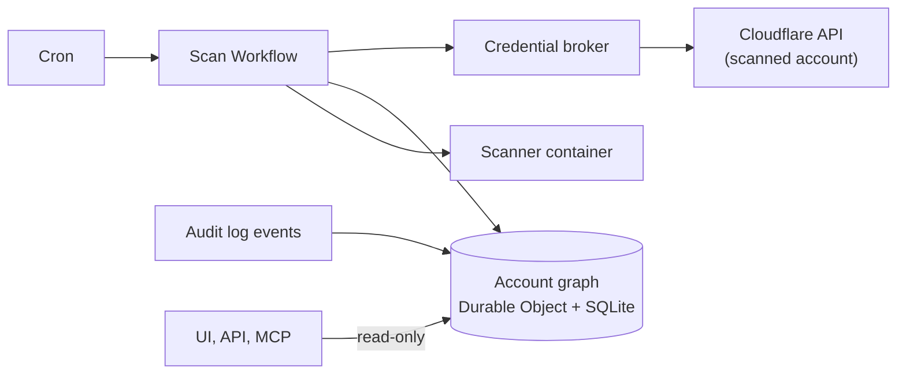

# Virga

An agentless, read-only security tool for Cloudflare accounts that runs entirely on Cloudflare. Virga models an account as a security graph. That graph connects entry points, Workers, data stores, identities, Zero Trust policies and private networks. Virga then finds toxic combinations that single configuration checks miss.

> *Virga* is rain that falls from a cloud but evaporates before it reaches the ground. The tool does the same with risk: it forms in the cloud and is caught before it hits anyone.

**Status: phase 1 in progress.** The concept, its review and the implementation plan are in [`docs/`](docs/). Built so far: the graph store, the rule compiler with the flagship rule CF-001, the core Worker with its Durable Object, the credential broker and the platform collectors. Nothing scans a real account yet.

## Documents

| Document | Content |
| --- | --- |
| [Design spec](docs/concept/design-spec.md) | Goal, scope, architecture, data model, rules, security of the tool, roadmap, positioning |
| [Analysis](docs/analysis.md) | Review of the spec: verified platform claims, inconsistencies, security additions, risks, open decisions |
| [Implementation plan](docs/implementation-plan.md) | Phases with gates, spikes, rule rollout, deployment topology, repository layout, phase 1 backlog |
| [Data model](docs/architecture/data-model.md) | Graph schema, write path, exposure semantics, rule file format, revised CF-001 |
| [Decisions](docs/decisions/) | Accepted decisions, starting with the working defaults |
| [Spikes](docs/spikes/) | Results of the phase 0 spikes |
| [Graph contract](docs/architecture/graph-contract.md) | What collectors emit and what rules and evaluators read |
| [Work packages](docs/team/work-packages.md) | How development is split across the agent team |

## Principles

1. **Agentless and read-only.** Everything goes through the Cloudflare API with an account-owned read-only token. Nothing is installed or changed in the scanned account.
2. **Runs entirely on Cloudflare.** Workers, Workflows, Durable Objects, Queues, R2, D1, Containers and Access.
3. **Simple to deploy.** Each operator runs their own instance in a dedicated account, and scan data stays there.
4. **Consume, don't rebuild.** Security Insights, the Access policy tester and unmodified open source scanners feed the graph.
5. **Open formats.** Findings as OCSF, SBOMs as CycloneDX, rules as code.

## Architecture at a glance



One Durable Object per scanned account holds the graph. Collectors fill it. Evaluators compute exposure and effective access. Rules written as SQL turn graph paths into findings.

## Development

Requirements: Node.js 22.13 or later and pnpm (via `corepack enable`).

```sh
pnpm install
pnpm ci            # lint, rule check, typecheck, tests
pnpm rules:build   # after changing anything in rules/
```

| Path | Content |
| --- | --- |
| `packages/graph` | Schema, migrations, write path (batch upsert, history, sweep) |
| `packages/cf-api` | Read-only Cloudflare API client contract, read allowlist, test transport |
| `packages/collectors` | Collectors that turn API responses into graph nodes and edges |
| `packages/exposure` | Exposure evaluator |
| `packages/rules` | Rule compiler, rule runtime, fixture runner |
| `rules/` | One directory per rule: `rule.sql`, fixtures, fix proposals |
| `apps/broker` | Credential broker: token vault, onboarding write check, read allowlist, rate budget |
| `apps/core` | Core Worker with the `AccountGraph` Durable Object |
| `spikes/` | Throwaway code for phase 0 spikes |

## License

Apache-2.0, see [LICENSE](LICENSE). Contributions require a DCO sign-off, see [CONTRIBUTING.md](CONTRIBUTING.md).

## Disclaimer

- Virga is an independent open source project. It is not affiliated with, endorsed by, or sponsored by Cloudflare, Inc.
- Cloudflare and the names of Cloudflare products belong to Cloudflare, Inc. They appear here only to describe what Virga works with.
- "Virga" is a meteorological term. The project claims no exclusive rights to the name.
- Use Virga only on accounts you own or are authorized to assess. The software is provided "as is", without warranty of any kind; see the [LICENSE](LICENSE).
