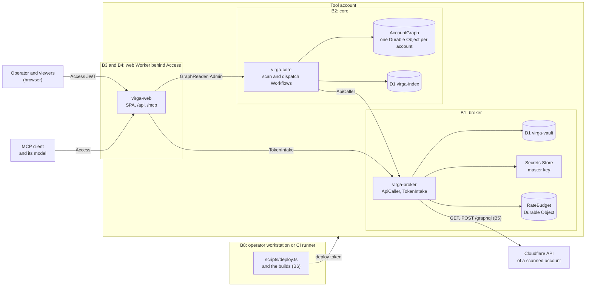

# Threat model v1

Status: v1, 2026-10-30 (phase 1 backlog item 15). It describes the code at commit 0812b03, the end of round 8. Round 9 is changing the deploy script, the release-age gate, the run-time rule guard and the web Worker, and adds the test range in Terraform; residual risks in its scope say which work package takes them. Updated after the round 9 merges where a residual risk changed (TM-08, TM-11, TM-13, TM-26, TM-29, TM-30, TM-31 and [Not built yet](#not-built-yet)); the [round 9 verification](../reviews/2026-10-30-verification-round-9.md) confirms them and found R9-01 to R9-06, which round 10 fixed; the [round 10 verification](../reviews/2026-10-30-verification-round-10.md) found R10-01 to R10-04, recorded under TM-29, TM-31 and TM-27. TM-13 and TM-32 record R9-01 to R9-04; R9-05 and R9-06 are in phase 2 packages that no scan uses yet. Nothing has scanned a real account yet, so every statement about Cloudflare's behavior comes from the docs and the spikes, not from a production run.

Virga is an independent open source project. It is not affiliated with or endorsed by Cloudflare, Inc., and it uses no Cloudflare logos (D-01).

## Scope and method

- **In scope:** the three Workers (`virga-broker`, `virga-core`, `virga-web`), their bindings and stored data, the deploy script and its builds, CI with the release-age gate, and the operator's workstation as far as it deploys or signs in.
- **Out of scope:** Cloudflare's own security ([SECURITY.md](../../SECURITY.md)), the configuration of the scanned accounts, and the parts of the design that do not exist yet: the phase 2 scanner container and the phase 3 event consumer (see [Not built yet](#not-built-yet)).
- **Method:** assets and principals first, then one section per trust boundary: what crosses it, the threats, the controls that exist in the code with file references, and the residual risks. Residual risks have IDs `TM-nn` and name the review finding or decision that records them. A control listed here exists at 0812b03; anything planned says so.

Sources:

| Source | Content |
| --- | --- |
| [Design spec](../concept/design-spec.md), "Security of the tool itself" | The intended controls |
| [Analysis](../analysis.md), "Security review: additions" and "Risks" | Broker read-only by construction, vault details, deploy pipeline, point 6 (Account API Tokens Read) |
| [Round 2 review](../reviews/2026-10-30-security-review.md) | R2-01 to R2-10 |
| [Round 3 review](../reviews/2026-10-30-security-review-round-3.md) | R3-01 to R3-07 |
| [Round 4 verification](../reviews/2026-10-30-verification-round-4.md) | R4-01 to R4-07 |
| [Round 5 verification](../reviews/2026-10-30-verification-round-5.md) | R5-01 to R5-08 and their leftovers |
| [Round 6 verification](../reviews/2026-10-30-verification-round-6.md) | R6-01 to R6-07 |
| [Round 7 review](../reviews/2026-10-30-review-round-7.md) | R7-01, R7-02 |
| [Round 8 verification](../reviews/2026-10-30-verification-round-8.md) | R8-01 to R8-03, leads R8-04 to R8-11, hardening notes |
| [Decisions](../decisions/) | 0001 (D-01 to D-15) to 0007 |

Every finding of rounds 2 to 7 is fixed, or its rest continues as a later finding. Open at 0812b03: R8-01 to R8-03 (R8-02 is the rest of R6-04), the leads R8-04 to R8-11 (R8-08 includes the Worker half of R5-07), the R5-08 leftovers, and the hardening notes of the round 8 verification. Each appears below as a residual risk.

## System overview

B7 (CI and the release-age gate) decides which code and packages reach B6 and the Workers.

## Assets

| ID | Asset | Where it lives | Why it matters |
| --- | --- | --- | --- |
| A1 | Scan tokens and the vault master key | Token ciphertexts in D1 `virga-vault`; the master key in Secrets Store (`virga-master-key`) or, as the D-15 fallback, the broker secret `MASTER_KEY` | Together they give read access to the configuration of every scanned account and, with the data groups the inventory profile needs today, to D1, KV and R2 data (TM-03). A token that could write would put the scanned account itself at risk |
| A2 | The deploy token | The CI secret store, or the operator's shell | It deploys the broker, so its holder can read every token (TM-01) |
| A3 | Graph and findings data | One `AccountGraph` Durable Object per scanned account; the account index D1 `virga-index`; retained Workflow instances; Worker logs | A map of each scanned account: entry points and their exposure, Access policies, the token inventory (TM-02), member emails. Findings say where each account is weakest |
| A4 | The operator's Access identity | The IdP account and the Access session; `ADMIN_EMAILS`; Access service tokens of MCP clients | Every identity that passes Access reads every account (TM-12). An admin identity onboards and removes accounts and starts scans |
| A5 | The tool account | Cloudflare account membership and the account's own API tokens | Its administrators can change any Worker, bind the vault and the master key elsewhere, and read everything above |
| A6 | The truth of the results | Exposure decisions, coverage, rule runs, findings | A false "protected" (an exposure decided `access`, or a finding resolved while the exposure stands) is invisible to the operator. Most findings of rounds 2 to 8 were of this kind |

## Principals

| Principal | Trust | What it reaches |
| --- | --- | --- |
| Operator (admin) | Trusted; an email in `ADMIN_EMAILS` behind Access | Onboarding, manual scans, removal, all data |
| Viewer | Trusted to read; any identity the Access policy admits | All data of all accounts (TM-12) |
| Scanned-account owners, and anyone who can write a string into a scanned account | Untrusted. Includes members with edit rights, a compromised member, and integrations that create resources | Every name, hostname, policy, ingress rule, variable and error text Virga reads, and the shape of the API responses as far as the configuration decides it (B5) |
| MCP clients and the models behind them | Trusted as far as their Access identity; a model can be steered by text in the data | The five read-only MCP tools, plus whatever other tools the client gives the model (B4) |
| Package and action publishers | Untrusted; checked for age and integrity only | Code that runs in the builds, the deploy process, the Workers and CI (B6, B7) |
| CI | Trusted to run the checks. The CI workflow holds no secrets | The checkout; a real deploy runs only in a separate workflow that the operator writes |
| Cloudflare, the platform | Trusted computing base | Runs every Worker, holds the master key, carries tokens to the API, keeps logs and backups |

## B1. Credential broker

**What crosses it.** Tokens come in once through `TokenIntake.store` from the web Worker. Read requests come from core through `ApiCaller.get` and `ApiCaller.graphql`. Requests with a token go out to `https://api.cloudflare.com/client/v4`.

**Threats**

- A write reaches a scanned account: through a token that can write, a crafted path, a GraphQL mutation or a redirect.
- A token leaves the broker: in a response, an error, a log line, a redirect, or a request for another account's path.
- A token that can write, has no expiry or lives long is stored.
- A vault row is decrypted for another account, or moved to one.
- The broker exhausts a token's quota, and Cloudflare blocks the token for 5 minutes.

**Controls**

| Control | Where |
| --- | --- |
| Only allowlisted reads leave the broker: explicit method and path patterns (GET, plus POST `/graphql`). A path must be plain: no query, fragment, encoded slash, empty segment, `.` or `..` | `packages/cf-api/src/allowlist/index.ts` (`isAllowedRead`, `isPlainPath`), `core.ts`, `platform.ts`, `identity.ts` |
| Data and secret endpoints are left out on purpose: script content, KV values, R2 objects, D1 queries, secret values, tunnel and Mesh tokens, single service tokens and IdPs | Comments in `packages/cf-api/src/allowlist/platform.ts` and `identity.ts` |
| Account scope: account IDs are 32 hex characters, a path under `/accounts/:id` must name the caller's account, query keys and values are checked | `apps/broker/src/upstream.ts` (`checkRest`) |
| GraphQL: a document with a mutation or subscription, or one the lexer cannot read, is refused (fail closed); variables are capped at 64 KiB | `apps/broker/src/graphql.ts` (`checkReadOnlyDocument`), `upstream.ts` (`checkGraphql`) |
| No token outside the broker: `redirect: "manual"`, the token is removed from response bodies, bodies over 16 MiB are refused, errors are logged by name only | `apps/broker/src/upstream.ts` (`send`, `readText`, `brokerErrorMessage`); test `apps/broker/test/leak.test.ts` |
| Onboarding write check: only account API tokens (`cfk_`, `cfut_` and `cfoat_` refused before any call); active and already valid; expiry within 90 days; every permission group of an allow policy a read group by name, unknown names refused (fail closed); an allow policy must name the scanned account; resources other than that account and single zones refused | `apps/broker/src/token-check.ts` (`writeCheck`), `write-check.ts`; test `apps/broker/test/write-check.test.ts` |
| Recheck before use (TM-04): `ApiCaller` runs the write check again before it uses a token whose last passed check is 24 hours old, or more than a minute in the future. One call per account at a time holds a claim on the vault row (it lapses after 30 s). The claim, the record of a pass and the deletion match the row on the token ID and the token's ciphertext, so a token stored meanwhile, even under the same ID, is neither deleted nor marked as checked (R10 hardening). A token that fails is deleted and the call answers 401 (99005; `NoPermissionError`, `no_permission` in core). A check that gets no answer keeps the token and fails the call closed (99006; 503, or 429 with `retryAfter`) | `apps/broker/src/token-check.ts` (`usableToken`, `recheckToken`), `vault.ts` (`claimRecheck`, `markChecked`, `deleteToken`, `SeenToken`), `migrations/0002_recheck_claim.sql`; tests `apps/broker/test/recheck.test.ts`, `apps/broker/test/vault.test.ts` |
| Envelope encryption: a random AES-256-GCM data key per token, wrapped with the master key; associated data binds account ID and token ID, and the wrapped key also the key version | `apps/broker/src/crypto.ts`, `vault.ts`, `migrations/0001_vault.sql` |
| The master key comes only from the Secrets Store binding when it is bound; a store error fails the call instead of falling back | `apps/broker/src/master-key.ts` |
| No routes, `workers.dev` and previews off, the default `fetch` answers 404. Only core binds `ApiCaller` and only web binds `TokenIntake` | `apps/broker/wrangler.jsonc`, `src/index.ts`; enforced at deploy by `scripts/lib/topology.ts` (`SERVICE_GRANTS`, `INTERNAL`) |
| The vault database and the master key are bound only to the broker (D-08, D-15) | `scripts/lib/topology.ts` (`KEY_HOLDER`, `checkTopology`), `scripts/lib/steps.ts` (`checkDatabaseIds`) |
| `TokenIntake` stores, rechecks and removes a token; it never returns one or uses it for anything else | `apps/broker/src/token-intake.ts` |
| Rate budget per account: margins of 120 REST and 30 GraphQL requests per 5 minutes, pacing in the last quarter, a block after a 429 until `retry-after` | `apps/broker/src/budget.ts`, `rate-budget.ts` |

**Residual risks**

| ID | Residual risk | Source |
| --- | --- | --- |
| TM-01 | Whoever can deploy `virga-broker`, or administers the tool account, can read every token. The protection is procedural: a protected CI environment with required reviewers, few members with security keys. The operator guide describes it; the repository cannot enforce it, and the deploy branch rules are unknown (lead R8-04) | [Analysis](../analysis.md#security-review-additions) item 5, R8-04 |
| TM-02 | Account API Tokens Read is required and exposes the metadata of every account token in the scanned account. See [below](#account-api-tokens-read) | [Analysis](../analysis.md#security-review-additions) item 6 |
| TM-03 | Until S-05 shows which Metadata Read-Only roles account tokens can select, the inventory profile needs D1 Read, Workers KV Storage Read and Workers R2 Storage Read. The broker never calls a data endpoint, but a token taken out of the vault can read data | D-14, S-05, operator guide ("Storage needs data groups for now") |
| TM-04 | Until round 10 the write check ran at onboarding only. Since `broker-2`, it runs again before a token is used once its last passed check is 24 hours old, and a token that fails is deleted. Left: a token whose policies are widened is still used for up to 24 hours, until its next recheck; a token that no call uses is not rechecked and stays stored until its next use or its expiry (90 days at most); a recheck that gets no answer keeps the token and fails the call. The allowlist still sends only reads | `apps/broker/src/token-check.ts`, `apps/broker/README.md` (Recheck before use); work package `broker-2` |
| TM-05 | The write check trusts the group names and resource keys the API returns. A group named like a read group that could write would pass. Zone resources are not checked against the account's zones; an account-owned token is expected to reach only its own account, which has not been verified | `apps/broker/src/write-check.ts`; S-05 |
| TM-06 | The master key depends on Secrets Store, which is in open beta. Rotation is a function (`rotateMasterKey`) without an entrypoint. A lost key means onboarding every account again | D-15, `apps/broker/README.md` |
| TM-07 | The rate budget's values come from the docs and one header observation. Behavior near the limit is unmeasured, and other clients of the same token share its quota. A 5-minute block stops that account's scans and nothing else | S-02, phase 1 gate item 5 |

## B2. Core, its Durable Objects and D1

**What crosses it.** Collector output from Workflow steps, made of strings from scanned accounts. RPC calls from the web Worker to `GraphReader` and `Admin`. Rows of the index database.

**Threats**

- A stale or concurrent scan marks live nodes as seen, and a newer scan's sweep tombstones them; their findings resolve.
- A rule writes to the graph, reads an input it did not declare, or resolves findings after a failure.
- Oversized input exhausts the object (rows, props, CPU).
- Offboarding leaves data behind, or a removed account is scanned again.
- Tokens or API bodies land in Workflow state or logs.
- A read reaches another account's graph.

**Controls**

| Control | Where |
| --- | --- |
| Only the running scan that is current in the graph writes. Every scan-scoped method checks it and throws `StaleScanError`; a sweep never moves `current_scan` (R2-07) | `apps/core/src/account-graph.ts` (`assertCurrent`), `packages/graph/src/write.ts`; tests in `apps/core/test/account-graph.test.ts` and `run.test.ts` |
| A class is swept only when its coverage is `complete`. A chunk that left resources out makes the class `partial` ([decision 0005](../decisions/0005-truncated-collection-coverage.md)) | `packages/graph/src/write.ts`, `apps/core/src/scan/run.ts` |
| Rules only read. The compiler refuses writes found by `EXPLAIN`, a statement tail, and inputs not listed in `requires` (R4-04, R4-05, R6-02). At run time a rule runs through `SqlRunner.queryReadOnly`, which rolls back any change of rows, schema or connection settings and ends the rule `error` ([decision 0006](../decisions/0006-read-only-rule-runs.md)) | `packages/rules/src/compile.ts`, `params.ts`; `packages/graph/src/sql.ts` (`guardRead`); test `apps/core/test/rules-runtime.test.ts` |
| Unknown is a result. A rule whose inputs are not all complete is `not_evaluated` and changes no finding; an undecided row neither opens nor resolves one | `packages/rules/src/evaluate.ts` |
| Input limits: native ID 512 characters, name 1,024, props 64 KiB per row; unknown node types refused | `packages/graph/src/types.ts` (`LIMITS`), `packages/graph/src/write.ts` (`prepareBatch`) |
| Values from scanned accounts are typed `Untrusted` at the RPC boundary | `apps/core/src/untrusted.ts`, `apps/core/src/graph/views.ts` |
| One Durable Object per account, named by its 32-hex account ID; `GraphReader` answers `null` for an account not in the index | `apps/core/src/graph-reader.ts`, `apps/core/src/scan/ids.ts` |
| Workflow steps return counters; only the plan step returns chunk units (at most 512 KiB). Workflow parameters hold the account ID. No token passes through core | `apps/core/src/scan/run.ts`, `workflows.ts` |
| Offboarding order: mark the account `removing`, delete the graph, then the index rows. A removed account is not scanned: the begin step checks the index, and the graph keeps a `removed` marker (R4-03, R5-08, R6-07) | `apps/core/src/admin.ts`, `account-graph.ts`, `index-db.ts`; tests `apps/core/test/admin.test.ts`, `index-db.test.ts`, `run.test.ts`, `workflow.test.ts` |
| No routes; reachable only through `GraphReader` and `Admin` from the web Worker. The index has its own database, apart from the vault (D-08) | `apps/core/wrangler.jsonc`, `src/index.ts`, `scripts/lib/topology.ts` |

**Residual risks**

| ID | Residual risk | Source |
| --- | --- | --- |
| TM-08 | Until round 9, the run-time guard missed a tail that drops a table and creates it again, and a view that shadows a `pragma_*` read, and the deploy shipped `rules.gen.ts` unchecked. Round 9 (`rules-6`, `deploy-3`): a read refuses any statement tail before it runs, on both adapters; the guard also compares which tables hold rows and sets every setting back, read with `PRAGMA`; the deploy compares the generated rules with compiler output after the builds and before every Wrangler call. Left: the guard alone does not see an index or trigger created again identically, or an empty table dropped and created again; the tail refusal keeps those out | [Decision 0006](../decisions/0006-read-only-rule-runs.md), round 8 hardening, lead R8-05 |
| TM-09 | Until round 10, `addAccount` and `removeAccount` for one account were not serialized. Since `core-6` they run one at a time in the account's graph object, and the last call decides the end state. Left: the queue is in memory, so a graph object restarted mid-change (for example by a deploy) drops it with the change under way, which leaves the state of a failed removal that a repeat finishes (R5-08). Graphs left by the removal order before round 6 are not detected | R5-08 leftovers, round 8 hardening |
| TM-10 | Data outlives offboarding: Durable Object point-in-time recovery (30 days; whether it restores a graph after `deleteAll` is not documented), D1 Time Travel on both databases, Workflow instances for 3 to 7 days, which hold coverage detail and chunk units as well as counters, and Worker logs | Operator guide ("What stays behind"), round 8 hardening |
| TM-11 | Since round 10 (`core-6`) a scan in which single rules ended `error` is `partial`, and `summary.detail` names up to 20 of them; per-rule errors stay in `ruleRuns`. Since round 9 (`rules-6`) the compiler refuses `@name`, `$name` and `#name` placeholders. Left: a rule may read the lifecycle tables without listing them in `requires` | Round 8 hardening |

## B3. Web Worker and Access

**What crosses it.** HTTPS requests from browsers and MCP clients through Worker-level Access. RPC calls to core (`GraphReader`, `Admin`) and to the broker (`TokenIntake`). The onboarding token passes through once.

**Threats**

- A request without a valid identity is served, or Access in front is misconfigured.
- A forged or replayed Access token is accepted.
- A viewer acts as an admin, or another site makes an admin's browser act (CSRF).
- A string from a scanned account runs as script in the SPA.
- The onboarding token leaks into a response or a log.
- A config change gives the web Worker the vault, the master key or `ApiCaller`.

**Controls**

| Control | Where |
| --- | --- |
| Every request, static assets included, needs an Access JWT: RS256 with a key from `<team domain>/cdn-cgi/access/certs`, `iss` equal to the team domain, `aud` containing `ACCESS_AUD`, `exp` and `nbf` with 30 s skew, `type` `app` when present. `ctx.access` is compared when present | `apps/web/src/auth.ts` (`authenticate`), `src/index.ts`, `wrangler.jsonc` (`run_worker_first`); test `apps/web/test/auth.test.ts` |
| Until `ACCESS_TEAM_DOMAIN` and `ACCESS_AUD` hold real values, every request answers 403 | `apps/web/src/auth.ts` (`accessConfig`) |
| Admin routes need an email in `ADMIN_EMAILS`; a service token is never admin | `apps/web/src/api.ts` (`handleApi`) |
| CSRF: a state-changing request needs a JSON body, an `Origin` equal to the Worker's own, and `Sec-Fetch-Site` `same-origin` or absent. Bodies are capped at 16 KiB | `apps/web/src/http.ts` (`refuseCrossSite`, `readLimited`) |
| Security headers on every response: CSP with `default-src 'none'` and scripts from `'self'` only, `frame-ancestors 'none'`, `nosniff`, HSTS | `apps/web/src/http.ts` (`CSP`, `SECURITY_HEADERS`) |
| The SPA renders strings from scanned accounts as React text only, replaces control and bidirectional characters, and draws graph labels as canvas text | `apps/web/spa/text.tsx`; test `apps/web/spa/render.test.tsx` |
| The onboarding token goes to `TokenIntake.store` and is not logged, echoed or kept; the broker's answer is rebuilt field by field and scrubbed of the token | `apps/web/src/api.ts` (`parseOnboarding`, `scrub`); test `apps/web/test/onboarding.test.ts` |
| Removal needs a body that names the account ID | `apps/web/src/api.ts`; test `apps/web/test/removal.test.ts` |
| The web Worker binds no D1 database, Durable Object, Workflow or Secrets Store, and never `ApiCaller`; the deploy refuses a config that does | `scripts/lib/topology.ts` (`STATELESS`, `SERVICE_GRANTS`) |
| Logs carry refusal reason codes and error names only | `apps/web/src/index.ts`, `apps/web/src/http.ts` (`logFailure`) |

**Residual risks**

| ID | Residual risk | Source |
| --- | --- | --- |
| TM-12 | No per-account access control: every identity that passes Access reads every account, and admin is a flat list of emails. The spec's per-account access control in D1 is not built | `apps/web/README.md` ("Known limits"), [design spec](../concept/design-spec.md#security-of-the-tool-itself) |
| TM-13 | Until round 9 Virga recorded no UI, API or MCP call. Since `web-export`, API requests and MCP tool calls land in `tool_audit` for 90 days. Round 10 (`web-audit-2`, `core-6`): a refused MCP body over 64 KiB gets 413 and one `refused` row (R9-03); identities core cannot store are refused with 403 (R9-04); one MCP request runs at most 8 tool calls and writes at most 9 rows; the hourly purge deletes up to 5,000,000 rows. Left: the `ui` channel comes from a header a client can set; audit writes are not rate limited beyond that, so only a rate above the purge's keeps rows past 90 days | Phase 1 backlog item 13, design spec ("Audit trail") |
| TM-14 | The Access JWT check is the only identity check inside the Worker: `ctx.access` does not reach a Worker with static assets, and S-08 has not confirmed the setup on a real account. When the certs endpoint fails, cached keys are used for up to 24 hours | [Analysis](../analysis.md#external-claims-checked) (`ctx.access`), S-08 |
| TM-15 | The Access application in front is the operator's configuration. A broad allow policy on the right application admits everyone it names to all data (TM-12). A request without a token, for example through a Bypass application on the hostname, is refused by the Worker | Operator guide ("Access for the UI") |
| TM-16 | The lockfile holds body-parser 2.3.0 and fast-uri 3.1.8, which have published advisories and reach `apps/web` through the MCP SDK. The patched versions pass the age gate on 2026-11-05 and 2026-11-02. Whether the advisories are reachable in Virga's use has not been assessed | [Work packages](../team/work-packages.md), round 5 status (R4-07 trade-off) |
| TM-17 | Personal data is stored in clear: member emails, email selectors of Access policies and similar values reach every viewer and MCP client. Pseudonymized user IDs are planned for phase 3 | Design spec ("Privacy"), [implementation plan](../implementation-plan.md#phase-3-zero-trust-and-change-events) |

## B4. MCP

**What crosses it.** Tool calls over HTTP at `/mcp`, behind the same Access check as every route. Tool results go into a model's context.

**Threats**

- Text written into a scanned account steers the model (prompt injection).
- A tool changes state.
- A web page in the user's browser calls the MCP server.
- The model sends data out through other tools of its client.
- A result floods the model's context.

**Controls**

| Control | Where |
| --- | --- |
| Five read-only tools, annotated `readOnlyHint`; none starts a scan or removes an account | `apps/web/src/mcp.ts` (`virgaMcpServer`) |
| Every result is a notice plus the data in one `<untrusted-data>` block. `<`, `>` and `&` are escaped, so a value cannot close the block. Strings, lists, keys and nesting are capped, and the text is shrunk until it fits 100,000 characters. The server instructions repeat the notice | `apps/web/src/untrusted.ts` (`UNTRUSTED_NOTICE`, `untrustedBlock`, `capJson`), `apps/web/src/mcp.ts`; test `apps/web/test/mcp.test.ts` |
| A browser `Origin` must be the Worker's own host, and no CORS headers are sent | `apps/web/src/mcp.ts` (`handleMcp`) |
| The same Access check as every other route | `apps/web/src/index.ts` |

**Residual risks**

| ID | Residual risk | Source |
| --- | --- | --- |
| TM-18 | The notice and the block advise the model; they do not enforce anything. A model can still follow text written into a scanned account. Virga's tools only read, but with TM-12 one session reads every account, and the client may give the model other tools (web, mail, files) that injected text can use to send data out. Virga cannot see or limit those tools | Design spec ("MCP and prompt injection") |
| TM-19 | How a non-browser MCP client passes Access (an Access service token or `cloudflared access`) is spike S-08. A service token admitted by the policy reads every account, and its secret lives on the client machine | Operator guide ("Access for the UI"), S-08 |

## B5. Scanned accounts' API responses

**What crosses it.** JSON from the Cloudflare API of a scanned account, through the broker, into the collectors and the graph. Whoever can configure the scanned account controls its content, and partly its shape.

**Threats**

- Markup or instructions in names reach the UI, MCP or logs (handled in B3 and B4).
- A secret value is copied into the graph.
- A huge configuration exhausts a step, a Durable Object or a scan.
- A crafted configuration makes Virga decide "protected", or resolves a finding while the exposure stands (A6).
- A response shape the collector does not expect reads as "nothing there".

**Controls**

| Control | Where |
| --- | --- |
| Collectors store names and derived facts, never the values of plain-text variables, secrets, tokens or keys. Credentials in tunnel service URLs are removed (R2-04) | `packages/collectors/src/platform/secrets.ts` (`detectSecret`, `inspectText`), `packages/collectors/src/identity/tunnels.ts` (`withoutCredentials`); graph contract ("Secrets never enter the graph") |
| Size limits: at most 1,000 entry points and 1 MiB of props per tunnel, and a node over the props limit is left out; each makes the class `partial` (R5-06, [decision 0005](../decisions/0005-truncated-collection-coverage.md)). The broker refuses bodies over 16 MiB | `packages/collectors/src/identity/tunnels.ts`, `packages/graph/src/types.ts`, `apps/broker/src/upstream.ts` |
| A value or shape that cannot be read is unknown or fails the chunk, never "clean" or "absent" (R4-02, R5-07, R6-05, R6-06) | `packages/collectors/src/platform/storage.ts`, `pages.ts`, `workers.ts`, `secrets.ts` (`UNINSPECTED`) |
| Exposure errs toward `public` or `unknown`: a Bypass never protects ([decision 0003](../decisions/0003-bypass-and-service-auth-exposure.md)), an Access wildcard covers one label (R2-03), paths are kept as configured (R2-05), `access_required` comes only from the rule's own block (R3-01), rules without a hostname become their own entry points (R3-02), unreadable targets and overrides are `unknown` (R2-06) | `packages/exposure/src`, `packages/collectors/src/identity/targets.ts`, `tunnels.ts`; graph contract ("Exposure semantics") |
| Tunnel entry point IDs cannot collide or be dropped for their length (R5-04, R5-05) | `packages/collectors/src/identity/tunnels.ts` |
| An end-to-end scan of a seeded fake account with hostile cases | `apps/core/test/e2e/account.ts`, `scan.test.ts` |

**Residual risks**

| ID | Residual risk | Source |
| --- | --- | --- |
| TM-20 | Response shapes nobody has observed can read as "nothing there", and the related findings resolve: tunnel ingress the collector cannot read (R8-06); a Worker version or Pages project without bindings or deployments (R8-08, which includes the Worker half of R5-07); an R2 bucket list without `buckets` (R8-09); a bucket in a jurisdiction, read without the `cf-r2-jurisdiction` header (R8-10); a tunnel with an unexpected `config_src`, which yields no entry point and no truncation. Each needs an observed API response | Round 8 verification, leads R8-06, R8-08 to R8-10, hardening |
| TM-21 | Detection limits that can hide something: a secret after the first 16 KiB of a value (R8-11); hostname case folded when tunnel rules shadow each other, while cloudflared may match case-sensitively (R8-07); tunnel hostnames that reach a tunnel only through DNS are unknown to the collector; a wildcard tunnel rule before an exact hostname is not treated as shadowing it, which errs toward `access` | Leads R8-07 and R8-11, graph contract ("Known limits of the per-rule model") |
| TM-22 | Anyone who can edit the scanned account can stop evaluation. One tunnel past 1,000 entry points or 1 MiB stops CF-004, CF-010 and CF-011 for the account; a response that fails a chunk stops the rules of its class; Worker findings of CF-024 freeze while `pages` is not complete; ingress rules with strings over 16,383 characters make the tunnel collector's work grow quadratically. No finding resolves, but none opens either; the scan shows `not evaluated` with a reason | Decisions [0004](../decisions/0004-cf-024-scope.md) and [0005](../decisions/0005-truncated-collection-coverage.md), R5-06, round 8 hardening |
| TM-23 | Accepted false positives: a Bypass limited to an office network, and a Service Auth policy for every address behind `access_required`, are reported public. They never hide an exposure, but operators suppress them, and a suppression hides later changes of that finding until it ends or the severity rises | [Decision 0003](../decisions/0003-bypass-and-service-auth-exposure.md), R4-01 |
| TM-24 | Code no review has covered yet: in B6, the per-app `deploy` scripts in `apps/*/package.json`, which run `wrangler deploy` without any check of the deploy script; in the collectors, offset pagination, the second tunnel listing in `tunnelsCollector.collect`, page-based listings through `listByPage`, and the other entry point reads of the Workers and Pages collectors | Round 8 verification ("Not covered") |

## B6. Deploy process and its builds

**What crosses it.** The deploy token, from the operator's environment or a CI secret, into `scripts/deploy.ts` and from there into Wrangler, which calls the API of the tool account. Build code (Vite, its plugins, their dependencies) runs in between.

**Threats**

- The token leaks: into output, a child process, Node's own debug output, a proxy, or another API host.
- Wrangler deploys a config the script did not check: another config file, a named environment, a `__proto__` member, `unsafe` bindings, a `build.command`.
- Build code changes a config, Wrangler or its dependencies after the checks.
- The web Worker gets the vault, the master key or `ApiCaller`; a D1 binding names one database and points to another.
- The token is uploaded as a Worker secret.

**Controls**

| Control | Where |
| --- | --- |
| The script refuses to run while variables are set that load code into it or print past its redaction (`NODE_OPTIONS`, `NODE_COMPILE_CACHE`, `LD_*`, `DYLD_*`, `NODE_DEBUG`, `OPENSSL_CONF`, R7-01, R7-02), that turn off TLS checks, that choose another environment or Worker name, or that point the API elsewhere (R5-03) | `scripts/lib/run.ts` (`UNSAFE_VARS`, `configOverrides`, `apiOverrides`), `scripts/deploy.ts` |
| Wrangler gets an allowlisted environment, `--config` with the checked file, `--env-file` with the null device, the public API base, stdin closed and no telemetry (R3-03, R5-03) | `scripts/lib/run.ts` (`wranglerEnv`, `processRunner`) |
| Builds run first and get no `CLOUDFLARE_` or `CF_` variable (R3-05). Then Wrangler's files are compared with a record taken before the builds, the app directories are checked again, and each config is read and hashed; the hash is compared before every Wrangler call (R6-01) | `scripts/deploy.ts`, `scripts/lib/wrangler.ts` (`recordWrangler`, `wranglerChanges`), `scripts/lib/config.ts` (`checkAppDir`, `readWorkerConfig`) |
| Configs are read as Wrangler reads them; `__proto__`, `constructor`, `prototype` and duplicate keys are refused (R5-01); each Worker may set only allowlisted keys (R5-02) | `scripts/lib/jsonc.ts` (`parseJsonc`), `scripts/lib/topology.ts` (`CONFIG_KEYS`, `NESTED_KEYS`) |
| Topology: Worker names, allowed service bindings and entrypoints, no routes on broker and core, the vault and Secrets Store only on the broker, a stateless web Worker, no bindings to another Worker's classes, no `env` blocks, no `CLOUDFLARE_` or `CF_` name in `secrets.required` (R3-04) | `scripts/lib/topology.ts` (`checkTopology`) |
| Each `database_id` must be the database its `database_name` names, and no database is bound by two Workers (R3-06) | `scripts/lib/steps.ts` (`checkDatabaseIds`, `ensureDatabases`) |
| Only `ACCESS_TEAM_DOMAIN`, `ACCESS_AUD` and `ADMIN_EMAILS` are uploaded as web secrets, through a private temporary file | `scripts/lib/steps.ts` (`WEB_SETTINGS`, `planWebSettings`, `withSecretsFile`) |
| All output passes a filter that removes the token and anything shaped like a Cloudflare credential | `scripts/lib/run.ts` (`redact`) |
| Tests for each of these | `scripts/test/` |

**Residual risks**

| ID | Residual risk | Source |
| --- | --- | --- |
| TM-25 | Build code runs as the operator while the deploy process holds the token. It can read the token from the process environment (on Linux, `/proc/<pid>/environ`), read anything else the user can, or change sources and migrations before Wrangler bundles them. The checks catch changed configs and Wrangler files, not this. Builds also get the operator's environment minus `CLOUDFLARE_` and `CF_` variables, including variables that make build tools load code | Operator guide ("What the build checks cover"), R6-01, round 8 hardening |
| TM-26 | Until round 9, corepack ran a build with the pnpm pin of `apps/<app>/package.json` and a `.corepack.env`, which the gate did not read. Round 9: the gate refuses a package manager named below the root and any `.corepack.env` (`supply-chain-3`); the deploy builds from the root with `COREPACK_ENV_FILE=0` and refuses app-level pins (`deploy-3`). Left: other `COREPACK_` variables of the operator's environment reach the builds | R8-02 |
| TM-27 | The Wrangler record is trust on first use, and pnpm's shared store carries an in-place edit into a fresh clone. Round 10 (`deploy-4`): the links of the workspace packages core and broker bundle are checked before and after the builds and before each Wrangler call, and `main` and `migrations_dir` stay in the app (L-2). Left: tsconfig `paths` and `baseUrl` can still point a bundled import elsewhere (R10-04) | Round 8 hardening, R10-04 |
| TM-28 | The redaction misses a token stored with a trailing newline, and the uploaded web settings join the redaction list only after the builds. On macOS, `DYLD_IMAGE_SUFFIX`, `DYLD_PRINT_ENV` and `DYLD_PRINT_TO_FILE` are not refused; the review rates them as within the documented residuals | Round 8 hardening |

TM-08 covers the generated rules that the deploy ships unchecked (R8-05).

## B7. CI and the release-age gate

**What crosses it.** Pushes and pull requests, which anyone with access to the repository can open; npm packages and GitHub Actions, which run on the runners.

**Threats**

- A malicious or very young package version gets installed.
- A lockfile layout that the gate reads differently from pnpm hides an entry.
- The pnpm version, or a pnpm plugin, is swapped.
- An action is changed under its tag.
- A deploy runs from a commit that skipped the checks.

**Controls**

| Control | Where |
| --- | --- |
| CI has `contents: read`, `persist-credentials: false`, actions pinned by commit SHA, and no secrets | `.github/workflows/ci.yml` |
| The `release-age` job runs before any job installs: every locked version is at least 14 days old and its integrity equals the registry's digest; the lockfile is read strictly; the pnpm in `packageManager` is dated too (R4-07, R6-03, R6-04); the root `.npmrc`, `pnpm-workspace.yaml` and the `pnpm` field are read strictly (R8-01, R9-01). The job installs nothing and runs no package code | `scripts/check-release-age.ts`, `.github/workflows/ci.yml`; test `scripts/test/check-release-age.test.ts` |
| `minimumReleaseAge` of 14 days for every resolution | `pnpm-workspace.yaml` |
| Exact versions; the exception list is empty, and adding an entry is the maintainer's decision | `scripts/check-release-age.ts` (`EXCEPTIONS`), [CONTRIBUTING.md](../../CONTRIBUTING.md) |
| Every push runs lint, `rules:check`, typecheck, the tests and a deploy dry run without credentials | `.github/workflows/ci.yml` |

**Residual risks**

| ID | Residual risk | Source |
| --- | --- | --- |
| TM-29 | Until round 9, `configDependencies` were installed, and plugins among them ran on every pnpm command, without being dated. Round 9 (`supply-chain-3`): the gate reads `pnpm-workspace.yaml` strictly and refuses `configDependencies` and every setting the project does not use. Round 10 (`supply-chain-4`): the gate reads the root `.npmrc` strictly, accepts no `pnpm` field in `package.json`, and refuses `resolutions` and a `pnpm` field below the root. Left: a root `.pnpmfile.cjs` runs on every pnpm command and can set any refused setting (R10-01, medium), and a project's `package.yaml` can carry `pnpm.executionEnv` (R10-02) | R8-01 (medium) |
| TM-30 | Until round 9, an exception for `name@version` also accepted a non-registry or unverifiable resolution under the same key. Round 9 (`supply-chain-3`): an exception names the failure it accepts and, for a non-registry package, its exact resolution; `unverified` and `mismatch` are never accepted | R8-03 |
| TM-31 | Whether a real deploy can run from a commit that skipped `release-age` or `rules:check` depends on branch rules and environments the repository does not show. Round 9: the guide's example and workstation steps run the gate before any install, a test holds every workflow and the example to that, `deploy-dry-run` needs `check`, and the deploy compares the generated rules itself. Left: the branch and environment settings; the workflow guard reads keys at fixed indents and `if:` as raw text (R10-03) | Leads R8-04 and R8-05 |
| TM-32 | Until round 10 the gate did not read `.npmrc` (R9-01, medium; R9-02), accepted a sha1 integrity equal to `dist.shasum`, folded file names with `toLowerCase` only (L-1), and `.nvmrc` followed the newest Node 22. Round 10 (`supply-chain-4`): the root `.npmrc` is read strictly and `.npmrc` below the root is refused; the locked integrity must use the strongest algorithm the registry publishes; names are fully case-folded; `.nvmrc` pins 22.23.3 and a test holds every `setup-node` to it. Left: the deploy half of R9-02 (`checkAppDir`, work package `deploy-4`) | Round 8 hardening, R9-01, R9-02 |
| TM-33 | The gate dates versions and compares digests; it does not judge content. A malicious version older than 14 days passes, and so does a malicious action at the commit it is pinned to | By design ([CONTRIBUTING.md](../../CONTRIBUTING.md), "Dependencies") |

## B8. Operator workstation

**What crosses it.** The deploy token when deploying locally, the master key when it is created, the Access session in the browser, and the `npx wrangler` commands of the operator guide.

**Threats**

- Malware or another process of the user reads the deploy token or the Access session.
- The token ends up in a shell history, a ticket or a log.
- A proxy with a trusted CA reads the token.
- A stolen admin session onboards, removes or reads accounts.

**Controls**

| Control | Where |
| --- | --- |
| The guide prefers deploys from CI, and otherwise from a fresh clone, as a user that holds no other credentials | [Operator guide](../operator/guide.md#what-the-build-checks-cover) |
| The master key goes from `openssl` to Wrangler through a pipe and is never shown; the deploy never reads it | Operator guide ("Master key") |
| The proxy settings passed to Wrangler are printed without credentials, with a warning about added CAs; `NODE_TLS_REJECT_UNAUTHORIZED` is refused | `scripts/lib/run.ts` (`proxyNotice`, `UNSAFE_VARS`) |
| Admin calls need a same-origin JSON request (CSRF) | `apps/web/src/http.ts` (`refuseCrossSite`) |

**Residual risks**

| ID | Residual risk | Source |
| --- | --- | --- |
| TM-34 | A workstation that deploys holds the token in its environment, and anything running as that user can take it. The guide's `npx wrangler` commands run without the deploy's checks: with the whole environment, the shim in `node_modules/.bin`, and `.env` loading. Wrangler's own login may sit in the home directory. A proxy whose CA is trusted can read the token | Operator guide ("What the build checks cover", "Behind a proxy") |
| TM-35 | The admin's browser session and IdP account are the admin. A stolen session or IdP account onboards, removes and reads every account until the session ends. Session length and MFA are settings of the operator's Access application | Operator guide ("Access for the UI") |

## Cloudflare as the platform

These are assumptions, not controls. The platform isolates Workers from each other, enforces service binding entrypoints, keeps Secrets Store values to the Workers bound to them, carries the broker's requests to `api.cloudflare.com` unaltered, and issues Access tokens only as the policies say. Cloudflare sees tokens in transit and keeps logs and backups (point-in-time recovery, Time Travel). Secrets Store is in open beta (D-15). Vulnerabilities in Cloudflare itself are out of scope ([SECURITY.md](../../SECURITY.md)).

## Account API Tokens Read

Point 6 of the [analysis](../analysis.md#security-review-additions): Account API Tokens Read shows the metadata of all account tokens. It is TM-02.

- **It is required.** The write check reads the token's own policies with `GET /accounts/{id}/tokens/{token_id}`, which needs Account API Tokens Read or Write. Write is refused, and a token without either is refused with `details_unavailable` (`apps/broker/src/token-check.ts`). So every scan token has the group. A token that loses the group later is deleted at its next recheck.
- **It reads every account token.** The same group lets `GET /accounts/{id}/tokens` list every account-owned token of the scanned account. The `tokens` collector stores per token its name, status, dates and expiry, permission groups, resources and IP condition, and the time of its last use as a signal ([graph contract](graph-contract.md#tokens)). It never stores a token value. User tokens of members are not listed.
- **Who sees it.** Every viewer and MCP client of the instance sees this inventory for every scanned account (TM-12): which tokens can write, to what, from where, whether they expire, and whether they are used. That is the list an attacker wants first. A compromise of the tool account, of the web Worker or of a single viewer identity hands it over for all accounts at once.
- **Why it stays.** CF-003 reads this data. Without the `tokens` collector the group would still be on the token, for onboarding.
- **What limits it.** The broker only reads, and only metadata; each read appears in the scanned account's audit log as a `view` action ([operator guide](../operator/guide.md#what-the-scanned-accounts-audit-log-shows)). Nothing hides token metadata from viewers, and there is no per-account access (TM-12). The onboarding text of the operator guide should say this before an account owner creates the token.

## Not built yet

Controls the design spec names that do not exist yet (after the round 9 merges):

| Control | Plan | Residual risk |
| --- | --- | --- |
| Per-account access control in D1 | Design spec ("Access to the UI"); not planned in a round yet | TM-12 |
| Signed releases with an SBOM | Phase 4 ([versioning policy](../release/versioning.md#what-a-release-contains)) | |
| Scanner containers without internet, pull credentials injected by an outbound handler, scanner images pinned by digest and signature-checked, scanner output validated; bundles in R2 deleted after one day | Phase 2, S-07 | |
| Audit Logs v2 polling and the change event consumer | Phase 3, S-06 | |
| Pseudonymized user IDs | Phase 3 | TM-17 |
| An entrypoint that rotates the master key | Not planned yet | TM-06 |
| A scheduled recheck of idle tokens (tokens in use are rechecked before use, at most every 24 hours) | Not planned yet | TM-04 |
| A test range that gives every rule a ground truth | Phase 1 backlog item 14; round 9 `terraform-1` wrote it (not yet validated with Terraform), it is applied when the account exists ([decision 0007](../decisions/0007-later-phases-before-the-phase-1-gate.md)) | TM-20, TM-21 |

## Open items that need the paid account or the test range

Nothing below can be settled in the repository or the local sandbox. Each item names the residual risks it affects.

| Item | What it settles | Affects |
| --- | --- | --- |
| S-01 | Workflow schedules, instance IDs and limits in practice; the 12-hour hung-scan threshold and retry waits of [decision 0002](../decisions/0002-scan-scheduling.md) | |
| S-02, rest | Behavior near the rate limit and the length of a block, in the test range | TM-07; phase 1 gate item 5 |
| S-03, production | CPU time of rule runs on large graphs in a deployed Durable Object | |
| S-04, API side | Whether `package_dependencies` and source maps come back in a regular account | Phase 2 |
| S-05 | Which permission groups and Metadata Read-Only roles account tokens can select; the version detail endpoint with Workers Metadata Read-Only; Pages Metadata Read and plain-text env vars ([decision 0004](../decisions/0004-cf-024-scope.md)); how "all zones" appears in a token's resources | TM-03, TM-05, TM-20 (R8-08) |
| S-06 | Audit Logs v2 polling, and whether the GraphQL `POST` is logged as a `view` action | Phase 3; the audit log promise of the operator guide |
| S-07 | Containers: `enableInternet = false`, outbound handlers, the permission for registry pull credentials | Phase 2 scanner controls |
| S-08 | Worker-level Access in front of the web Worker, `ctx.access`, and how MCP clients pass Access | TM-14, TM-19 |
| Test range | Phase 1 gate item 3 (each rule hits its seeded case and stays quiet on the clean one), and observed responses and cloudflared behavior for the leads R8-06, R8-07, R8-09, R8-10 and R8-11 | TM-20, TM-21 |
| Phase 0 gate | Spikes S-01 to S-06 and S-08 answered, and a test range account | All of the above |
| Phase 1 gate | 1: a fresh deploy with the script and the guide. 2: the write check test (automated in `apps/broker/test/write-check.test.ts`). 3: the test range. 4: the tool's own account and one other real account scanned end to end. 5: a full scan within the rate budget. 6: no `public` decision on entry points a manual review marks as protected, on a sample of at least 50 | A6, TM-07, TM-20 |
| Deploy branch settings on GitHub | Branch rules and the protected environment of the real deploy workflow | TM-01, TM-31 |
| Items marked **verify** in the [operator guide](../operator/guide.md) | Workers Admin for the first deploy, Account Settings Read for Wrangler, the Security Center Insights group, point-in-time recovery after `deleteAll` | TM-10 |

## Keeping this model current

Update it when a trust boundary, a binding or a token profile changes, and after each review round: new residual risks get the next `TM-nn` ID, and a fixed one stays listed with the fix and its review ID until the next version of this model.
