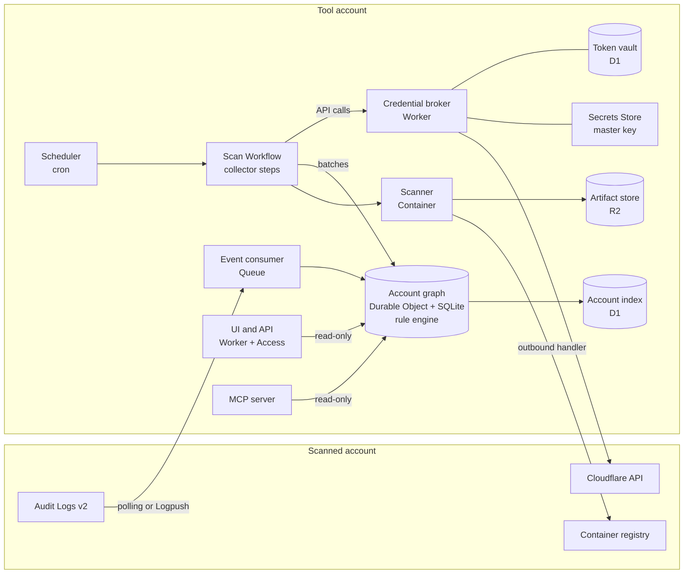
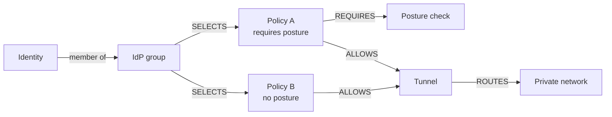

# Virga: CNAPP for Cloudflare, on Cloudflare

Design spec · Oct 29, 2026 · @Roland

Companion tabs: Implementierungsplan and Prüfbericht.

> **Repository note.** This file is the design spec of 2026-10-29, adapted for the repository. The original embeds three diagrams that the export does not contain: the architecture and Zero Trust diagrams are reconstructed below as Mermaid from the surrounding text, the roadmap is replaced by a pointer. The companion tabs were not exported either. Their repository counterparts are [analysis.md](../analysis.md) (review of this spec) and [implementation-plan.md](../implementation-plan.md).

**Virga** is rain that falls from a cloud but evaporates before it reaches the ground. The tool does the same with risk: it forms in the cloud and is caught before it hits anyone.

## Goal and scope

An agentless, open source tool models Cloudflare accounts as a security graph and finds toxic combinations that single checks miss. It runs entirely on Cloudflare itself.

**Problem.** Security Insights checks configuration: DNS, TLS, WAF, Access, Tunnels, API Shield and account settings. It does not look at Workers code, npm dependencies or container images, and it does not connect resources through their bindings, routes and policies. The container registry has no vulnerability scanning. Cloudflare has announced dependency vulnerability alerting and offers Worker code analysis by invitation through Managed Defense. The tool therefore positions itself as the graph and correlation layer that consumes these native signals as they appear.

**Scope v1**

- Inventory and graph across all Cloudflare services: Application Services, Developer Platform, Cloudflare One (Zero Trust), network services, account and identities
- Exposure analysis: effective reachability per hostname, path and private network
- Workload scanning: Worker bundles (SCA, secrets) and container images (CVEs)
- Rules for toxic combinations, findings with a fix proposal as a Wrangler or Terraform diff

**Non-goals**

- No inline control and no blocking. WAF, Access and Gateway do that.
- No write permissions in the scanned account. One-time setup steps that need write access (such as a Logpush job) are done by the customer, not by the tool.
- No replacement for AWS, Azure or GCP CNAPPs. Findings export to them.

## Design principles

Five principles keep the open source edition and a possible native Cloudflare edition on one code base.

1. **Agentless and read-only.** Everything runs through the Cloudflare API with an account-owned read-only token. Nothing is installed or changed in the scanned account. Every read the tool makes shows up in the customer's Audit Logs v2 as a `view` action, which makes the tool's behavior transparent to the customer.
2. **Runs entirely on Cloudflare.** Workers, Workflows, Durable Objects, Queues, R2, D1, Containers and Access. No external database, no Kubernetes. The tool doubles as a reference architecture for security workloads on the Developer Platform.
3. **Simple to deploy.** A deploy script around `wrangler deploy` sets up a fresh instance. Each operator runs their own instance in a dedicated tool account. Configuration and code of scanned accounts are copied there and stay under the operator's control; nothing goes to third parties.
4. **Consume, don't rebuild.** Security Insights, the Access policy tester and, once available, native dependency metadata feed into the graph. Scanners such as Trivy, osv-scanner and gitleaks run unmodified in containers.
5. **Open formats.** Findings as OCSF, SBOMs as CycloneDX, rules as code in the repository. The tool fits next to existing CNAPPs and SIEMs.

## Architecture overview

One Durable Object per scanned account holds the graph. Every other component either fills it or reads from it.

*Architecture · 12 components, one graph per account* (reconstructed from the text)



The Workflow and the event consumer write into the account graph; UI, MCP server and the D1 index read from it. Collectors reach the Cloudflare API only through the credential broker, and the scanner container pulls images from the registry and stores SBOMs in R2.

## Components

Every component maps to one Cloudflare building block. The core is one Durable Object per scanned account that holds the graph in its own SQLite database.

| Component | Cloudflare building block | Role |
| --- | --- | --- |
| Scheduler | Cron schedule on the Workflow binding | Fires periodically; the instance fans out one scan per due account |
| Orchestration | [Workflows](https://developers.cloudflare.com/workflows/reference/limits/) | Scan as steps with retries. 10,000 steps per instance by default, up to 25,000; up to 5 minutes CPU per step. A step returns at most 1 MiB, so steps write to the graph directly and return only counters |
| Collectors | Workflow steps | Call the Cloudflare API, normalize into nodes and edges |
| Graph store | [Durable Object with SQLite](https://developers.cloudflare.com/durable-objects/platform/limits/), one per account | Nodes, edges, versions, findings. Up to 10 GB per object, tenant isolation by object boundary |
| Artifact store | R2 | Worker bundles (kept one day), SBOMs, scanner databases, OCSF exports |
| Scanner | Containers | Trivy, osv-scanner, gitleaks unmodified. No internet; registry access and scanner database through outbound handlers |
| Change events | Audit Logs v2: API polling by default, customer-created Logpush job as an option | Incremental graph updates and detections within minutes |
| Rule engine | Inside the Durable Object | Rules as SQL over the graph, compiled at build time |
| UI and API | Worker with Static Assets, Access on Worker level | Graph explorer, findings, export |
| Agent interface | MCP server on Workers (`createMcpHandler`) | Read-only tools over graph and findings |
| Token vault | D1 with AES-256-GCM envelope encryption, master key in Secrets Store | Read-only tokens of scanned accounts, any number, no redeploy. Only a credential broker Worker holds the key and calls the API |
| Account index | D1 | Accounts, scan runs, summaries, access control |

## Data model: the security graph

The graph lives in two core tables, `nodes` and `edges`, in the SQLite database of the account object. Paths such as “internet to data store” are recursive SQL queries with a depth limit; no separate graph database is needed.

**Node types**

| Type | Examples | Source |
| --- | --- | --- |
| Entry point | Custom Domain, route, `workers.dev`, preview URL, R2 public domain, tunnel public hostname | Zones, DNS, Workers, R2, Tunnel APIs |
| Edge control | WAF ruleset with action and overrides, Access app with policies, Gateway policy | Rulesets, Access, Gateway APIs |
| Workload | Worker script, Worker version, deployment, container application, image reference | Workers versions and deployments, Containers API |
| Package | npm package with version, OS package | `package_dependencies`, SBOM |
| Data store | R2 bucket, D1, KV, Durable Object namespace, Queue | Product APIs |
| Identity | Member, account token, service token, Zero Trust user, IdP group, identity provider | Members, Tokens, Access APIs |
| Device | Device profile (client lock, split tunnel), enrollment policy, posture check | Devices API |
| Private network | CIDR route, hostname route, virtual network, tunnel, Mesh node, infrastructure target | Teamnet, Zero Trust routes, Tunnel APIs |
| Finding | Security Insight, CVE, rule hit | Security Center, scanners, rules |

**Edge types**

- `ROUTES_TO`: entry point → Worker, bucket or tunnel target
- `PROTECTED_BY`: entry point or Worker → Access app or ruleset, with the level (host, path, Worker)
- `BINDS`: Worker version → data store, container or another Worker, keyed by binding name
- `RUNS` and `CONTAINS`: container app → image → package, Worker version → package with a detection confidence; `DEPLOYS`: Worker script → version with its traffic share
- `EGRESS`: container → allowed host or internet
- `CAN`: identity → resource, permission as attribute
- `SELECTS`: policy → group, IdP, service token or Everyone (include, require, exclude)
- `ALLOWS`: policy → app or private network, conditions as attributes
- `REQUIRES`: policy → posture check
- `PRECEDES`: policy → policy, to model evaluation order
- `ROUTES` and `IN`: tunnel or Mesh node → private network → virtual network
- `INCLUDES` and `EXCLUDES`: device profile → CIDR or domain (split tunnel)
- `AFFECTS`: finding → affected node

Every node and edge carries a content hash, `observed_at`, `first_seen` and a tombstone. A row is written only when its hash changes, which keeps write costs low; a completeness marker per resource class decides tombstones. A changes table keeps attribute history, so any two scans can be diffed. Audit events are triggers only: they mark nodes dirty and cause a targeted refetch, so a late event never overwrites newer state.

Exposure is policy evaluation, not graph traversal. Access denies without a match, Gateway network policies allow without a match, the most specific route wins and a Custom Domain beats a route. A TypeScript evaluator computes exposure per entry point and path prefix into an `exposure` table with decision, confidence and the deciding policy as reason. Expressions it cannot evaluate yield `unknown`, never `public`.

Findings live in their own table with a stable fingerprint, rule version, status, time-boxed suppression and the ID of the Security Insight they enrich.

## Collection flows

Four flows fill the graph: a periodic inventory scan, workload scanning, traffic as a reachability signal, and change events from the audit log.

**A. Inventory scan**

1. The cron schedule on the Workflow fires. The instance starts one scan per due account, with a deterministic instance ID per hour so duplicates are rejected.
2. One step per resource class and chunk (for example 25 zones or 20 Workers): zones and DNS, rulesets, Workers with bindings and routes, storage, containers, Access, Gateway, tunnels and routes, devices, tokens, members, Security Insights.
3. Each step calls the API through the credential broker, writes its batch straight into the account object and returns only counters. A 403 marks the collector as “no permission”; dependent rules are reported as “not evaluated”, never as passed.
4. Last: sweep deleted resources, compute exposure, run rules, write findings, diff against the previous scan.

Account tokens get [1,200 API requests per 5 minutes](https://developers.cloudflare.com/fundamentals/api/reference/limits/), and exceeding that blocks the token for 5 minutes. A small budget object per account paces requests using the `Ratelimit` response header.

**B. Workload scanning**

1. For each active Worker version (Deployments API), the collector loads all modules including source maps through the beta Versions API with `include=modules`. The script `etag` detects changes.
2. Packages come primarily from the version field `package_dependencies`, which Wrangler 4.110 and later uploads ([changelog](https://developers.cloudflare.com/changelog/post/2026-07-07-wrangler-deploy-upload-dependencies-metadata/)). Fallbacks are source maps, uploaded by default since Wrangler 4.150, and banner comments.
3. gitleaks scans bundles for secrets, including the Cloudflare token prefixes `cfat_` and `cfut_`. A match links to the token inventory.
4. For container images, a step requests short-lived pull credentials from the registry credentials API. An outbound handler injects them, so the scanner container never sees them. Trivy writes a CycloneDX SBOM to R2.
5. A daily job rematches stored SBOMs against new CVEs without rescanning. Scanner databases are mirrored to R2 and served to the containers through an outbound handler.

**C. Traffic as reachability**

The GraphQL dataset `workersInvocationsAdaptive` returns requests and errors per script and lands on the Worker node as `traffic_7d`. A CVE in a Worker with traffic weighs more; a Worker without traffic for 30 days is a deletion candidate.

**D. Change events and detection**

1. By default, the tool polls `GET /accounts/{id}/logs/audit` with a cursor (Account Settings Read). Optionally, the customer creates a Logpush job for `audit_logs_v2` into the tool's R2 bucket; an R2 event notification then feeds a Queue.
2. The consumer drops the tool's own `view` events by token ID and processes the rest idempotently by audit log ID.
3. For relevant events (new token, changed policy, new route) it refetches the resource, updates the graph and evaluates detection rules.

Latency is minutes, not seconds. [Audit Logs v2](https://developers.cloudflare.com/fundamentals/account/account-security/audit-logs/) covers about 95 % of products, keeps 18 months and, since 13 October 2026, also records `view` actions (GET requests).

## Rule engine and toxic combinations

Each rule is one file in the repository: ID, version, title, severity, kind (posture, toxic, detection), the collectors it needs, a single `SELECT` or `WITH` query and fix templates. Rules compile at build time and ship with positive and negative fixtures. There is one finding per fingerprint, and a rule that enriches a Security Insight references its ID instead of reporting it again.

CF-001 is the flagship. A Worker version qualifies when it is served by a public entry point, contains a package with an open critical or known-exploited vulnerability detected with at least medium confidence, and reaches a data store or secret directly or through one service binding. Traffic is a severity modifier, not a condition: a forgotten public Worker is not safe, only unnoticed.

```sql
-- CF-001: public Worker, exploitable critical vulnerability, access to persistent data
-- Parameters: :sev_min (default 4 = critical), :min_conf (default 1 = medium)
WITH
public_entry AS (
  SELECT x.entry_id, n.native_id AS host, x.confidence
  FROM exposure x
  JOIN nodes n ON n.id = x.entry_id AND n.deleted_at IS NULL
  WHERE x.decision = 'public'
),
served AS (
  -- route, Custom Domain, workers.dev -> active versions per deployment
  SELECT r.src AS entry_id, s.id AS script_id, d.dst AS version_id
  FROM edges r
  JOIN nodes s ON s.id = r.dst AND s.type = 'worker_script' AND s.deleted_at IS NULL
  JOIN edges d ON d.src = s.id AND d.type = 'DEPLOYS' AND d.deleted_at IS NULL
  WHERE r.type = 'ROUTES_TO' AND r.deleted_at IS NULL
    AND COALESCE(json_extract(d.props, '$.percentage'), 100) > 0
  UNION
  -- version and preview URLs point straight at a (possibly old) version
  SELECT r.src, json_extract(v.props, '$.script_node_id'), v.id
  FROM edges r
  JOIN nodes v ON v.id = r.dst AND v.type = 'worker_version' AND v.deleted_at IS NULL
  WHERE r.type = 'ROUTES_TO' AND r.deleted_at IS NULL
),
vuln AS (
  SELECT c.src AS version_id, vu.vuln_id, vu.kev
  FROM edges c
  JOIN nodes p ON p.id = c.dst AND p.type = 'package' AND p.deleted_at IS NULL
  JOIN vulns vu ON vu.package_id = p.id
  WHERE c.type = 'CONTAINS' AND c.deleted_at IS NULL
    AND COALESCE(json_extract(c.props, '$.confidence'), 0) >= :min_conf
    AND vu.status = 'open'
    AND (vu.severity_rank >= :sev_min OR vu.kev = 1)
),
store_types(t) AS (
  VALUES ('r2_bucket'), ('d1_database'), ('kv_namespace'), ('do_namespace'),
         ('hyperdrive_config'), ('secrets_store_secret')
),
data_access AS (
  -- direct binding of the version
  SELECT b.src AS version_id, b.dst AS store_id, b.key AS binding
  FROM edges b
  JOIN nodes t ON t.id = b.dst AND t.deleted_at IS NULL
  WHERE b.type = 'BINDS' AND b.deleted_at IS NULL
    AND t.type IN (SELECT t FROM store_types)
  UNION
  -- one hop through a service binding to the target's active version
  SELECT b1.src, b2.dst, b1.key || '>' || b2.key
  FROM edges b1
  JOIN nodes s2 ON s2.id = b1.dst AND s2.type = 'worker_script' AND s2.deleted_at IS NULL
  JOIN edges d2 ON d2.src = s2.id AND d2.type = 'DEPLOYS' AND d2.deleted_at IS NULL
  JOIN edges b2 ON b2.src = d2.dst AND b2.type = 'BINDS' AND b2.deleted_at IS NULL
  JOIN nodes t2 ON t2.id = b2.dst AND t2.deleted_at IS NULL
  WHERE b1.type = 'BINDS' AND b1.deleted_at IS NULL
    AND t2.type IN (SELECT t FROM store_types)
)
SELECT
  'CF-001'                             AS rule_id,
  'CF-001:' || sv.script_id            AS fingerprint,
  sv.script_id                         AS worker,
  group_concat(DISTINCT sv.version_id) AS versions,
  group_concat(DISTINCT pe.host)       AS entry_points,
  group_concat(DISTINCT vu.vuln_id)    AS vulnerabilities,
  group_concat(DISTINCT da.store_id)   AS data_stores,
  min(pe.confidence)                   AS exposure_confidence,
  CASE
    WHEN max(vu.kev) = 1 THEN 'critical'
    WHEN COALESCE(json_extract(s.props, '$.invocations_30d'), 0) > 0 THEN 'critical'
    ELSE 'high'
  END                                  AS severity
FROM public_entry pe
JOIN served sv      ON sv.entry_id = pe.entry_id
JOIN nodes s        ON s.id = sv.script_id
JOIN vuln vu        ON vu.version_id = sv.version_id
JOIN data_access da ON da.version_id = sv.version_id
GROUP BY sv.script_id;
```

**Rules for applications and the Developer Platform**

| ID | Combination | Severity | Fix proposal |
| --- | --- | --- | --- |
| CF-001 | Public entry point → Worker version → open critical or known-exploited vulnerability → data store or secret, directly or via service binding. Critical with KEV or traffic in 30 days, else High; a matching WAF virtual patch lowers one level | Critical | Update the package; put Access or a WAF rule in front |
| CF-002 | Worker with one entry point behind Access and another one public (`workers.dev`, version or preview URL, extra route or domain). Also when Worker-level Access is on but a host or path app with Bypass or Everyone sits on one of its domains, because host apps take precedence | High | [Worker-level Access](https://developers.cloudflare.com/workers/configuration/cloudflare-access/), which covers routes, Custom Domains, `workers.dev` and previews, or `workers_dev = false` and `preview_urls = false`; validate the Access JWT in code |
| CF-003 | Account-owned token with a high-risk write permission (Workers, DNS, Access, account settings, API tokens, Logs, Secrets Store, Zero Trust), no expiry or more than 90 days, no IP condition. One level up when unused for 90 days or scoped to all zones | High | Short lifetime with rotation; delete unused tokens |
| CF-004 | Published tunnel hostname with exposure public. Critical when the origin service is not HTTP (SSH, RDP, SMB, TCP). References the Security Insight instead of duplicating it | High | Access app with a policy; private routes are covered by CF-014 |
| CF-005 | Container reachable from a public entry point through Worker and Durable Object, image with an open HIGH or CRITICAL vulnerability that has a fix, open egress, secrets passed as environment variables. Medium without a public path | High | `enableInternet = false`, outbound handler with token injection, rebuild the image |
| CF-006 | Public Worker without recognizable authentication and with data store bindings. An MCP or agent signature (MCP SDK imports, `/mcp` paths, no OAuth provider) raises it to Critical | High | OAuth or Access in front, fewer bindings |
| CF-007 | Unproxied A or AAAA record pointing to an IP that is also the target of a proxied record (Cloudflare and tunnel ranges excluded). High when the proxied host is protected by WAF or Access | Medium | Tunnel or Authenticated Origin Pulls, rotate the origin IP |
| CF-008 | Running container instance on an outdated image. Deferred to phase 2: the instances API returns the image reference, not always a digest | Medium | Restart through Durable Object logic |
| CF-009 | No invocations in 30 days across all triggers, but bindings to a production data store. Public Workers fall under CF-001 or CF-006 instead | Low | Delete the Worker or remove bindings |
| CF-021 | R2 bucket public through `r2.dev` or a custom domain without Access | High | Disable `r2.dev`, put Access on the custom domain |
| CF-022 | Pages project with public preview deployments and bindings to production | Medium | Protect previews with Access, separate bindings |
| CF-023 | Detection: new or changed Logpush job with an external destination | High | Verify the change; restrict Logs Write |
| CF-024 | Secret in a plain-text variable instead of a secret binding | Medium | Move to a secret binding and rotate the value |

## Coverage of all Cloudflare services

Every service whose configuration or logs are reachable through the API or Logpush is covered. What is new compared with Security Insights is not the single check but the correlation across domains.

| Domain | Services | What is collected | Source |
| --- | --- | --- | --- |
| Application Services | DNS, SSL/TLS, WAF, Bot Management, API Shield, Client-Side Security, Load Balancing, Spectrum | Proxy status, TLS mode, rule action and overrides per phase, API operations, script inventory | DNS, Zone Settings, Rulesets (zone and account entrypoints), API Gateway, Page Shield, Spectrum, Load Balancer APIs; Security Insights |
| Developer Platform | Workers, Containers, R2, D1, KV, Durable Objects, Queues, Workflows, Workers AI, AI Gateway | Bindings, routes, versions, bundles, packages, images, traffic | Workers versions and settings, Containers applications and instances, GraphQL Analytics |
| Cloudflare One: access | Access (apps, policies, service tokens, IdPs), Infrastructure Access, MCP server portals | Who may reach what under which conditions, actual logins | Access API, Access users, policy tests; Logpush `access_requests`, `ssh_logs`, `mcp_portal_logs` |
| Cloudflare One: internet and private traffic | Gateway (DNS, HTTP, network), TLS decryption, Browser Isolation, DLP | Policies in precedence order, TLS decryption state, hits per policy | Gateway API; Logpush `gateway_*` |
| Cloudflare One: devices | Cloudflare One Client, device profiles, enrollment, posture checks | Client lock, split tunnel, enrollment rules, posture results | Devices API, Access users `last_seen_identity`; Logpush `device_posture_results`, `warp_toggle_changes` |
| Cloudflare One: networks | Tunnels, CIDR and hostname routes, virtual networks, Cloudflare Mesh (formerly WARP Connector) | Routes per tunnel and virtual network | `cfd_tunnel`, Teamnet routes and virtual networks, `/zerotrust/routes/hostname`, `warp_connector` |
| Cloudflare One: SaaS and email | CASB, Email Security | Findings, integration status | Logpush `casb_findings`, `email_security_alerts` |
| Network services | Magic Transit, Cloudflare WAN, Cloudflare Network Firewall | Prefixes, firewall rules, IDS detections | `/magic/*` APIs, Rulesets; Logpush `magic_ids_detections` |
| Account and identity | Members, roles, account tokens, SSO enforcement, MFA | Permissions per identity, token usage, admin activity | Members, Tokens, SSO connectors, Audit Logs v2 |

For Zero Trust, [Security Insights](https://developers.cloudflare.com/security/security-insights/) today covers single points: Access policies that allow everyone, tunnels without Access, exposed RDP servers, CASB status and new integrations, unassigned Access seats, and admin users without MFA.

## Zero Trust: effective access

The biggest gain is one question: who actually reaches which internal network, and under which conditions? The answer is a path from the identity through group, policy and posture to tunnel and private network.

*Zero Trust path · five hops, one gap* (reconstructed from the text)



The group reaches the network through two policies. Because policy B demands no posture, the posture check of policy A protects nothing (rule CF-015).

**Evaluation order for a private network**

1. Device enrollment allows the identity.
2. The device profile sends the destination into the tunnel (split tunnel include or exclude).
3. A route for the destination exists in the virtual network.
4. Gateway DNS policies, then Gateway network policies in precedence order. A block ends evaluation; unmatched traffic is allowed by default.
5. An Access private app on the destination is evaluated after all Gateway network policies (most specific destination wins, hostname before IP), unless a network policy with `access.private_app` pulls Access evaluation forward.
6. Within an Access app, Bypass and Service Auth policies run first, then Allow and Block in order. Include is OR, require is AND, exclude is NOT.

Sources: [order of enforcement](https://developers.cloudflare.com/cloudflare-one/traffic-policies/order-of-enforcement/), [self-hosted private apps](https://developers.cloudflare.com/cloudflare-one/access-controls/applications/non-http/self-hosted-private-app/), [Access policies](https://developers.cloudflare.com/cloudflare-one/access-controls/policies/).

**Three analyses**

1. **Effective access.** For every private network and app: which identities reach it under which conditions. In reverse, the blast radius of a group, a service token or a device.
2. **Granted versus used.** Access logins and Gateway sessions show who actually uses an app. Grants without use become candidates for removal, as with unused permissions in CIEM.
3. **Policy gaps.** A destination is reachable over two paths and only one demands posture. Only the graph sees this; a single check does not.

**Rules for Zero Trust**

| ID | Combination | Severity | Fix proposal |
| --- | --- | --- | --- |
| CF-010 | Allow policy with include Everyone or include login method One-time PIN on an app whose target has data store bindings or is a tunnel target. Enriches the insight “Overprovisioned Access Policies” | Critical | Restrict include to IdP groups, limit allowed login methods to the corporate IdP |
| CF-011 | Bypass policy on an app whose target is a Worker with data store bindings, a tunnel target or a private destination. Bypass runs first, enforces nothing and is not logged | High | Separate host or path app for truly public paths; Service Auth for machine access |
| CF-012 | Private destination allowed for Everyone while device enrollment admits anyone (Everyone, any One-time PIN address or service token enrollment) | High | Limit enrollment to IdP groups; app policy on groups plus posture |
| CF-013 | Service token with no expiry or more than 365 days left, used in Service Auth on a production app, not seen for 90 days. Separate medium finding for the selector “Any Access Service Token” | High | Delete, or reissue with a limited duration; replace “any token” with named tokens |
| CF-014 | Route broader than a threshold (default /16), not excluded by split tunnel in at least one profile, with neither an Access private app nor a catch-all block in Gateway network policies. Every enrolled user reaches the whole range | High | Narrow routes; catch-all block at the bottom with an `access.private_app` allow above it |
| CF-015 | Destination reachable over two effective paths, at least one without posture (for example a Gateway allow next to an Access app with posture, or Bypass next to Allow) | High | Demand posture on every remaining path, close the extra paths |
| CF-016 | Device fails a posture check, yet later opens a session or logs in to a destination whose policy demands that check | High | Close the path without posture (CF-015); short session lifetimes |
| CF-017 | HTTP policies active while TLS decryption is off. HTTP policies then do not apply to HTTPS at all. High when they include block or DLP without an equivalent DNS or network block | Medium | Enable TLS decryption with do-not-inspect exceptions, or move hostname blocks to network policies with SNI |
| CF-018 | Device profile with the client switch not locked, applied to users under Gateway filtering | Medium | Lock the client switch, use admin override codes for exceptions |
| CF-019 | Super Administrator without activity in Audit Logs v2 for 90 days, or more super admins than a threshold | Medium | Reduce role or remove member; threshold configurable |
| CF-020 | Identity allowed by policy but without login or session to the app for 90 days | Low | Remove from the granting group or narrow the policy |

**Privacy**

- Zero Trust data is personal data: email addresses, devices, access. Managing Logpush jobs for Access, Gateway and DEX requires Logs Edit plus Zero Trust PII Read, so the customer creates these jobs.
- In Germany, per-person usage analysis typically involves the works council's co-determination rights. The default is pseudonymized user IDs (HMAC); names appear only inside a specific finding.
- Cloudflare keeps Access logs between 24 hours and 180 days depending on plan. Rules over 90 days therefore need Logpush into R2, which is optional.

## Security of the tool itself

The tool concentrates read access to the configuration and code of many accounts. That makes it a target in its own right, so it is hardened accordingly.

- **Two token profiles.** “Inventory” uses metadata permissions only and no data access. “Workload scan” adds code read for bundles. Note that some read permissions reach data: D1 Read allows queries and KV Read returns values, so they are only requested where metadata is not enough.
- **Write check at onboarding.** `tokens/verify` returns the token ID; `GET /accounts/{id}/tokens/{id}` returns its permission groups. Every group ID is checked against an allowlist; any write, edit or admin group rejects the token. Expiry must be 90 days or less.
- **Token vault.** Tokens are encrypted with AES-256-GCM in D1; the only secret in Secrets Store is the master key. Only a credential broker Worker can decrypt; it calls the Cloudflare API itself, so tokens never appear in workflow state or logs. Workflow retention is kept short.
- **Separation of duties.** The core Worker that holds tokens has no routes, `workers.dev` and preview URLs are off. UI, API and MCP Workers have no token access and read the graph through a read-only entrypoint over a service binding. The tool account is dedicated, has few members with security keys and deploys only through CI.
- **Access to the UI.** Access on Worker level plus JWT validation in code; per-account access control in D1.
- **Sensitive artifacts.** Bundles can contain secrets. The R2 bucket is private, a lifecycle rule deletes bundles after one day, and secret findings are stored masked.
- **Scanner containers.** `enableInternet = false`, only the registry host allowed, pull credentials injected by an outbound handler, non-root user. Scanner output is treated as untrusted and validated against a schema with size limits.
- **MCP and prompt injection.** Only read-only tools with output limits. Every string from a scanned account (Worker names, DNS records, policy names) is marked as untrusted data for the model.
- **Audit trail.** UI, API and MCP calls land in a tool audit table. On the customer side, every read appears as a `view` action in Audit Logs v2.
- **Dogfooding and supply chain.** The first scanned account is the tool's own. Pinned dependencies, signed releases and an SBOM for every release. Scanner images and their databases are pinned by digest and signature-checked, because scanners are supply chain targets themselves. The scanner never fetches a URL found in scanned data.

## Roadmap

Four phases, each closing with a measurable gate. Dates are open and depend on the start; the implementation plan estimates effort per phase.

*Roadmap · four phases with gates, dates open*: the embedded roadmap was not part of the export. The proposed phases and gates are in [implementation-plan.md](../implementation-plan.md).

Phase 1 uses configuration data only and runs without containers. Containers arrive with workload scanning in phase 2.

## Positioning: open source and Cloudflare pitch

Open source first, pitch second: the running project is the proof, and the pitch asks for integration into the platform.

**Open source**

- Apache-2.0 with a DCO, so a later adoption by Cloudflare does not fail on licensing.
- Deployed by script into the operator's own account; scan data stays there.
- Rules as community contributions, as with established open source CSPM tools.
- Audience: teams with significant Developer Platform or Cloudflare One usage, and MSSPs with many Cloudflare accounts.

**Next to native features**

| Native feature | What it covers | What the tool adds |
| --- | --- | --- |
| Security Insights | Single configuration checks, scan cadence by plan | Correlation across domains, workloads, paths |
| Access policy tester | Who may reach an Access app, including last posture, also via API | Cross-path view: enrollment, split tunnel, routes, Gateway order, Access |
| Vulnerability Discovery in Managed Defense (by invitation) | Worker code analysis with patch and WAF proposals | Dependencies, images, graph context |
| Dependency vulnerability alerting (announced) | Future native alerting on npm packages | Consumed as a source once available |
| API Shield vulnerability scanner (beta) | DAST for broken object level authorization | Out of scope |

**Pitch to Cloudflare**

1. **Close the gap.** Security Center stops at configuration. Customers running Workers and Containers in production ask for vulnerability management of exactly these workloads.
2. **Reference architecture.** The tool shows Workflows, Durable Objects, Containers, Queues and R2 in a real security workload, and it is demo material for Solutions Architects.
3. **Concrete product asks.** Dependency metadata in a stable API, including transitive dependencies. Image scanning in the registry. A read-only permission for registry pull credentials. Read access to Logpush job configuration without write permission. A read-only token or role for Organizations. A Gateway policy simulation API. A configuration snapshot or change stream API, so large accounts need not be crawled.

## Later and optional

These constraints are real, but they do not shape the core design. Each one is handled later or as an optional mode, so the spec above describes the normal case.

| Topic | What it means | Handling later |
| --- | --- | --- |
| EU Customer Metadata Boundary | With the EU boundary, some Logpush datasets deliver nothing (Audit Logs, CASB findings, device posture, DLP copies), Access user logs are not available by API outside the US region, and `workersInvocationsAdaptive` is US only | Optional EU mode: detect the boundary, mark affected rules as “not evaluated”, use polling |
| Large accounts and rate limits | A full scan of 500 zones and 1,000 Workers needs roughly 45 to 90 minutes at 1,200 requests per 5 minutes | Adaptive cadence, rotate zone details across scans, event-driven updates, request higher limits on Enterprise |
| Registry pull permission | The permission needed for the registry credentials API is undocumented and may require Containers Write | Test in phase 2; if write is needed, a separate optional token for image scanning |
| External registries | Images on Docker Hub, ECR or Artifact Registry are not cached by Cloudflare and need customer credentials | After the Cloudflare registry is covered |
| Account token gaps | Account tokens do not support Zero Trust Client Platform, Super Bot Fight Mode, Turnstile and Page Rules | Collector reports “no permission”; optional user token fallback |
| Group membership in the IdP | Zero Trust knows users only after enrollment or login; Access decides on IdP claims at login, SCIM groups feed Gateway | Two views (SCIM for Gateway, last login identity for Access); optional read-only IdP connectors |
| Admin activity | Members have no last-login field; organization super admins do not appear in account member lists | Activity from Audit Logs v2; flag invisible privileged identities |
| Locally managed tunnels | Ingress rules of tunnels configured on the origin are not reliably readable by API | Map DNS records that point to `cfargotunnel.com` |
| Exposure precision | Snippets, Origin Rules, Transform Rules and some precedence details are not modeled in the MVP | `exposure_confidence`, refined iteratively |
| Security Insights above 10,000 zones | No aggregation on account level | Query per zone |
| Usage-based access analysis | `access_requests` only records logins; 90-day rules need Logpush or Enterprise log retention | Phase 3, optional |

Also deferred: a build-time SBOM pushed from CI as a higher-confidence package source, a cross-account identity index for members and tokens that span several accounts, Workers for Platforms dispatch namespaces, and a re-identification role with logging for pseudonymized users.

## Sources

- [Security Insights](https://developers.cloudflare.com/security/security-insights/)
- [Workflows limits](https://developers.cloudflare.com/workflows/reference/limits/)
- [Durable Objects limits](https://developers.cloudflare.com/durable-objects/platform/limits/)
- [API rate limits](https://developers.cloudflare.com/fundamentals/api/reference/limits/)
- [Containers outbound traffic](https://developers.cloudflare.com/containers/platform-details/outbound-traffic/)
- [Registry credentials API](https://developers.cloudflare.com/api/resources/containers/subresources/registries/subresources/credentials/methods/generate/)
- [Workers versions (beta) API](https://developers.cloudflare.com/api/resources/workers/subresources/beta/subresources/workers/subresources/versions/methods/get/)
- [Dependency metadata in Worker uploads](https://developers.cloudflare.com/changelog/post/2026-07-07-wrangler-deploy-upload-dependencies-metadata/)
- [Workers authorization roles](https://developers.cloudflare.com/workers/authorization/workers/)
- [Workers and Cloudflare Access](https://developers.cloudflare.com/workers/configuration/cloudflare-access/)
- [Secrets Store with Workers](https://developers.cloudflare.com/secrets-store/integrations/workers/)
- [Audit Logs v2](https://developers.cloudflare.com/fundamentals/account/account-security/audit-logs/)
- [Audit Logs v2 view actions](https://developers.cloudflare.com/changelog/post/2026-10-13-audit-logs-v2-view-actions/)
- [Logpush permissions](https://developers.cloudflare.com/logs/logpush/permissions/)
- [Gateway order of enforcement](https://developers.cloudflare.com/cloudflare-one/traffic-policies/order-of-enforcement/)
- [Access policies](https://developers.cloudflare.com/cloudflare-one/access-controls/policies/)
- [Self-hosted private apps](https://developers.cloudflare.com/cloudflare-one/access-controls/applications/non-http/self-hosted-private-app/)
- [TLS decryption](https://developers.cloudflare.com/cloudflare-one/traffic-policies/http-policies/tls-decryption/)
- [Zero Trust networks API](https://developers.cloudflare.com/api/resources/zero_trust/subresources/networks/)
- [Cloudflare Mesh](https://developers.cloudflare.com/changelog/post/2026-04-14-cloudflare-mesh/)
- [Product name updates](https://developers.cloudflare.com/changelog/post/2026-02-17-product-name-updates/)
- [Logpush datasets under the metadata boundary](https://developers.cloudflare.com/data-localization/metadata-boundary/logpush-datasets/)
- [Zero Trust log retention](https://developers.cloudflare.com/cloudflare-one/insights/logs/)
- [Account-owned tokens](https://developers.cloudflare.com/fundamentals/api/get-started/account-owned-tokens/)
- [Organizations limitations](https://developers.cloudflare.com/fundamentals/organizations/limitations/)
- [Vulnerability Discovery and Remediation](https://blog.cloudflare.com/vulnerability-discovery-remediation/)
- [MCP handler API](https://developers.cloudflare.com/agents/api-reference/mcp-handler-api/)
