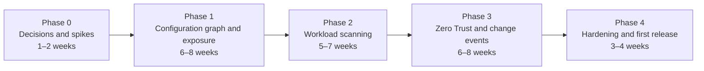

# Implementation plan

Status: proposal, 2026-10-29. The design spec refers to a companion "Implementierungsplan" tab that was not exported. This plan was written from the [design spec](concept/design-spec.md) and the review in [analysis.md](analysis.md). Decision IDs (D-xx) refer to [analysis.md § Open decisions](analysis.md#open-decisions). Spike IDs (S-xx) are defined below.

## Approach

- **Vertical slices, not layers.** Every phase ends with findings a person can act on, in a deployed instance, against a real account.
- **Dogfooding from day one.** The tool account is the first scanned account (design spec, "Dogfooding and supply chain").
- **A seeded test account ("test range").** A separate Cloudflare account, built with Terraform, has one deliberate misconfiguration per rule and a clean counterpart next to each. It gives every gate a ground truth: each rule must hit its seeded case and stay quiet on the clean one.
- **Read-only by construction.** The broker sends only allowlisted read calls (GET, plus POST for GraphQL queries), even if a token could do more. This is defense in depth on top of the onboarding write check.
- **Unknown is a result.** Missing permissions, unsupported expressions and missing coverage show up as `not evaluated` or `unknown`. They are never reported as passed or as public.

## Phases

The spec defines four phases with gates and fixes three anchors: phase 1 uses configuration data only and runs without containers; containers and workload scanning arrive in phase 2; usage-based access analysis is phase 3. Everything else below is a proposal. Effort is a rough estimate for one experienced developer, to be checked after phase 1.



### Phase 0: decisions and spikes

Progress (2026-10-29): decisions recorded as working defaults ([0001](decisions/0001-working-defaults.md)); S-03 answered locally, S-02 and S-04 partly; results in [spikes/](spikes/). Backlog items 1 (scaffold), 6 (account graph object, without the read entrypoint) and 11 (rule compiler and fixture runner, without the findings lifecycle) are done ahead of phase 1.

Not a product phase. It settles the open decisions and tests the assumptions that the design depends on before any code is built on them.

| Spike | Question | Result needed |
| --- | --- | --- |
| S-01 | Workflows: `schedules` on the Workflow binding as the cron, instance ID format (at most 100 characters, pattern `^[a-zA-Z0-9_][a-zA-Z0-9-_]*$`), duplicate-ID behavior within the retention period, step and CPU limits in practice | Dispatcher design confirmed, chunk sizes set |
| S-02 | API rate limit for account-owned tokens, the `Ratelimit` header, GraphQL limits | Rate budget object design and pacing values |
| S-03 | Durable Object SQLite: run the schema, the JSON batch upsert and CF-001 in a real object. Recursive CTEs, triggers, CPU time of a rule run on a synthetic graph of 20,000 nodes, cost of row writes | Schema v1, write strategy (D-05) |
| S-04 | Workers Versions API (beta) with `include=modules`. Does `package_dependencies` (`name`, `packageJsonVersion`, `installedVersion`) include devDependencies and transitive packages? Is there a size cap? Are source maps present with a current Wrangler? | Package source priority and confidence levels |
| S-05 | Permission groups. Minimal read set per collector. Which product-level Metadata Read-Only roles (Workers, D1, KV, R2, Queues, Hyperdrive) can an account token select? Does Workers Metadata Read-Only cover scripts, settings, bindings, routes and deployments (one community report says deployments return 401)? Does Pages Metadata Read return a project with the values of its plain-text env vars ([decision 0004](decisions/0004-cf-024-scope.md))? | Token profiles (D-14), onboarding allowlist, scope of CF-024 |
| S-06 | Audit Logs v2 polling: cursor handling, volume of the tool's own `view` events per scan, server-side filter `actor_token_id.not` | Event poller design, cost of polling |
| S-07 | Containers: `enableInternet = false`, outbound handlers, permission for registry pull credentials | Phase 2 scanner design, or a separate optional token |
| S-08 | Worker-level Access for the UI: `ctx.access` identity plus JWT validation as a second check; Access or OAuth in front of the MCP server | Web Worker auth design |

**Gate:** decisions D-01 to D-15 recorded; spikes S-01 to S-06 and S-08 answered (S-07 may run into phase 1); test range account exists.

### Phase 1: configuration graph and exposure

**Scope**

- Monorepo, CI and a deploy script that sets up a fresh instance with one command
- Credential broker with token vault, onboarding write check, rate budget
- Account graph object (schema, migrations, upsert, sweep, history), scan Workflow with dispatcher and coverage
- Collectors:
  - zones, DNS
  - Workers: scripts, settings and bindings, routes, Custom Domains, `workers.dev` and preview URL settings, deployments, version metadata
  - Pages
  - R2, D1, KV, Queues, Durable Object namespaces, Hyperdrive, Secrets Store
  - Access: apps, policies, groups, service tokens, IdPs
  - tunnels with public hostnames
  - account tokens, members
  - Security Insights
  - GraphQL traffic
- Exposure evaluator v1: Workers, R2 and tunnel hostnames; Access host, path and Worker-level apps; Bypass and Everyone
- Rule compiler with fixtures, findings lifecycle, scan diff
- Web Worker: account list, findings, finding detail with graph neighborhood, OCSF JSON export, tool audit trail
- Rules: see [rule rollout](#rule-rollout)

**Gate**

1. A fresh deploy into an empty tool account works with the deploy script and the operator guide.
2. A token with any write, edit or admin permission group, without expiry, or with more than 90 days to expiry, is rejected at onboarding (automated test).
3. Test range: every phase 1 rule hits its seeded case and stays quiet on the clean counterpart.
4. The tool's own account and at least one other real account are scanned end to end. Missing permissions show as `not evaluated`.
5. A full scan of the test range does not exceed the rate budget (no 429, no 5-minute block).
6. Exposure: zero `public` decisions on entry points that a manual review marks as protected, on a reviewed sample of at least 50 entry points.

### Phase 2: workload scanning

**Scope**

- Worker bundles through the Versions API, `etag`-based change detection, package extraction (Wrangler dependency metadata, then source maps, then banner comments) with a confidence per source
- Scanner container (Trivy, osv-scanner, gitleaks unmodified) with no internet, outbound handlers for the registry and the scanner database mirror in R2
- Container applications and images, registry pull credentials injected by the outbound handler, CycloneDX SBOMs in R2
- `vulns` table and a daily rematch without rescanning; KEV feed
- Secret findings linked to the token inventory (`cfat_`, `cfut_`, `cfk_`), stored masked
- MCP server with read-only tools (`createMcpHandler` from `agents/mcp/server`; `McpAgent` is deprecated)
- Rules: CF-001, CF-005, CF-006, CF-008

**Gate**

1. CF-001 reports the seeded vulnerable Worker in the test range within one scan, including the service binding variant.
2. SBOMs validate against the CycloneDX schema.
3. An egress test inside the scanner container proves that only allowlisted hosts are reachable.
4. No bundle object older than one day exists in R2.
5. A newly published advisory, simulated by updating the mirrored database, raises a finding without a rescan.
6. Scanner output that breaks the schema or size limits is rejected (fuzz test).

### Phase 3: Zero Trust and change events

**Scope**

- Collectors: Gateway (DNS, HTTP, network policies with precedence, TLS decryption), devices and profiles, posture checks, enrollment, CIDR and hostname routes, virtual networks, Mesh, infrastructure targets
- Zero Trust evaluator for effective access, computed per group and selector, not per user
- Change events: Audit Logs v2 polling by default, optional Logpush into R2 with a Queue; dirty marks and targeted refetch
- Pseudonymized user IDs (HMAC) by default
- Optional usage-based analysis from Logpush datasets in R2
- Rules: CF-012 to CF-020, CF-023, and the Zero Trust parts of CF-010 and CF-011

**Gate**

1. Test range scenarios for every Zero Trust rule, including the two-path posture gap (CF-015), are detected.
2. Effective access matches the Access policy tester API on a sample of at least 50 identity and app pairs.
3. A configuration change in the test range shows in the graph within 10 minutes (p95) with polling.
4. No personal names appear outside a single finding's detail view (automated check over API responses).

### Phase 4: hardening and first release

**Scope**

- Fix proposals as Wrangler and Terraform snippets per rule
- OCSF export validated against the schema; SIEM and CNAPP export guide
- Optional EU mode (detect the metadata boundary, mark affected rules `not evaluated`)
- Large-account mode: adaptive cadence, rotating zone details
- Signed releases with SBOM; scanner images pinned by digest and signature-checked
- Operator documentation, threat model, contribution guide for rules
- Non-affiliation notice in the README, UI and docs (D-01)
- Versioning policy, changelog and release notes

**Gate**

1. A fresh install from a signed release passes the phase 1 to 3 gates on the test range.
2. A third party deploys an instance using only the documentation.
3. Release notes and the versioning policy are published with the release.

## Rule rollout

| Rule | Phase | Needs | Notes |
| --- | --- | --- | --- |
| CF-002 | 1 | Workers, routes, Access | Needs Access host-app precedence in the evaluator |
| CF-003 | 1 | Account tokens | Account tokens only. User tokens of members cannot be listed with an account token |
| CF-004 | 1 | Tunnels, Access, Security Insights | Enriches the insight |
| CF-007 | 1 | DNS | Cloudflare IP ranges and tunnel ranges as reference data |
| CF-009 | 1 | Workers, storage, GraphQL traffic | One 30-day query fits the `workersInvocationsAdaptive` window |
| CF-010 | 1 | Access, Workers, tunnels | Access part only; enrollment-related parts arrive in phase 3 |
| CF-011 | 1 | Access, Workers, tunnels | Private destinations arrive in phase 3 |
| CF-021 | 1 | R2, Access | |
| CF-022 | 1 | Pages, Access | |
| CF-024 | 1 | Workers and Pages settings | Built-in patterns for known token prefixes; gitleaks in phase 2. One rule for both ([0004](decisions/0004-cf-024-scope.md)) |
| CF-001 | 2 | Workers, packages, vulns, storage, exposure | Flagship |
| CF-005 | 2 | Containers, images, vulns, exposure | Needs the Worker → Durable Object → container path |
| CF-006 | 2 | Workers code, exposure, storage | "Recognizable authentication" and the MCP signature need code |
| CF-008 | 2 | Container instances | Spec defers it; depends on digests |
| CF-012 to CF-018 | 3 | Zero Trust collectors and evaluator | CF-016 needs posture results over time; Cloudflare keeps them 30 days, longer needs Logpush |
| CF-019 | 3 | Members, Audit Logs v2 | |
| CF-020 | 3 | Access logins | 90 days need Logpush or Enterprise retention |
| CF-023 | 3 | Audit Logs v2 events | Detection rule over `events`, not graph state |

## Deployment topology (proposal)

Three Workers in phase 1, a scanner container in phase 2. Each binding is granted only where it is needed (D-06, D-08).

| Worker | Exposure | Bindings | Role |
| --- | --- | --- | --- |
| `virga-broker` | No routes, `workers.dev` and previews off | Vault D1, master key (Secrets Store), rate budget Durable Object | Holds and uses tokens. RPC entrypoints `ApiCaller` (read calls with path allowlist) and `TokenIntake` (store, recheck, and remove with the account's rate budget) |
| `virga-core` | No routes, `workers.dev` and previews off | Account graph Durable Object, scan Workflow, index D1, R2, Queue, `ApiCaller` | Cron, Workflows, collectors, evaluators, rules. RPC entrypoints `GraphReader` (read-only) and `Admin` |
| `virga-web` | Custom domain, Worker-level Access, JWT validated in code | `GraphReader`, `Admin`, `TokenIntake`, static assets | UI, API, MCP. No vault, no D1, no Durable Object stubs |

The vault and the account index live in separate D1 databases. A D1 binding cannot be read-only, so the vault binding exists only on the broker.

The deploy script enforces this topology (R5-02). Each Worker's Wrangler config may use only the keys listed for it in `CONFIG_KEYS` and `NESTED_KEYS` (`scripts/lib/topology.ts`); unsafe bindings, preview bindings, named environments and custom build commands are refused. `virga-web` binds no Workflows, and no Worker binds another Worker's Durable Object or Workflow classes.

## Repository layout (proposal)

```
apps/
  broker/        credential broker Worker
  core/          Workflow, account graph Durable Object, event consumer, cron
  web/           UI, API and MCP Worker with static assets
  scanner/       container image and Container class (phase 2)
packages/
  graph/         schema migrations, type registry, upsert and sweep, query helpers
  cf-api/        typed read client, pagination, rate budget client
  collectors/    one module per resource class: fetch -> normalize -> batch
  exposure/      exposure evaluator
  vulns/         advisory matching and rematch (phase 2)
  scanner-io/    scanner output readers, CycloneDX SBOMs (phase 2)
  zt/            Zero Trust evaluator (phase 3)
  rules/         rule compiler, fixture runner, findings lifecycle
  ocsf/          OCSF mapping
  shared/        types, crypto helpers, untrusted-string marking
rules/           CF-xxx/rule.sql, fixtures/, fix/
infra/
  test-range/    Terraform for the seeded test account (cases.yaml lists the cases per rule)
spikes/          throwaway code for phase 0 spikes
scripts/         deploy and setup scripts
docs/
```

**Toolchain (proposal, D-02):** TypeScript strict, pnpm workspaces, Wrangler 4, Vitest with `@cloudflare/vitest-pool-workers`, `wrangler types` for bindings, Biome for lint and format, Zod for runtime validation of API responses and scanner output, GitHub Actions with actions pinned by SHA. Dependencies are pinned, and every release ships an SBOM.

## Token profiles and permissions

The spec defines two profiles. Names come from the API token permissions reference and, for the granular Workers and product roles, from the Workers authorization docs (checked 2026-10-29). Spike S-05 checks them against the permission groups API before the onboarding allowlist is written.

| Resource class | Candidate permission group (read) | Profile |
| --- | --- | --- |
| Zones, DNS, zone settings | Zone Read, DNS Read, Zone Settings Read | Inventory |
| Rulesets, WAF | Account Rulesets Read, Account WAF Read, Zone WAF Read, Firewall Services Read | Inventory |
| Workers scripts, routes, settings, deployments | Workers Metadata Read-Only (granular role since 2026-09-15), Workers Routes Read | Inventory. Not Workers Scripts Read: it now maps to Content Read-Only and reads code |
| Worker bundles (code) | Workers Content Read-Only or Workers Scripts Read | Workload scan |
| Queues, Hyperdrive, Pages, Secrets Store | Queues Read, Hyperdrive Read, Pages Metadata Read, Secrets Store read (name to confirm) | Inventory |
| D1, KV, R2 | Product-level Metadata Read-Only if account tokens offer it (S-05); otherwise D1 Read, Workers KV Storage Read, Workers R2 Storage Read | Inventory with Metadata Read-Only. The Read groups reach data and stay optional; without them, names come from the Worker bindings (D-14) |
| Containers | Containers Read; registry credentials permission undocumented (S-07) | Workload scan |
| Access, Gateway, devices, tunnels, routes | Access: Apps and Policies Read; Access: Organizations, Identity Providers, and Groups Read; Access: Service Tokens Read; Zero Trust Read; Cloudflare Tunnel Read; Cloudflare One Networks Read | Inventory |
| Account tokens, members, audit logs | Account API Tokens Read (also needed for the onboarding self-check), Account Settings Read | Inventory |
| Traffic | Account Analytics Read | Inventory |
| Security Insights | Account Security Center Insights | Inventory |

## Testing strategy

| Level | What | How |
| --- | --- | --- |
| Normalizers | API response → nodes and edges | Recorded, sanitized API responses with snapshot tests |
| Evaluators | Exposure and Zero Trust decisions | Table-driven tests built from the precedence rules in the Cloudflare docs |
| Rules | Each rule, positive and negative | Fixtures run in Node SQLite for speed and in the Workers pool for parity with Durable Object SQLite |
| Integration | Workflow → broker → graph → rules | `vitest-pool-workers` with a mocked Cloudflare API |
| End to end | Full deployment against the test range | Nightly scan, findings compared with the expected list |
| Security | Write-check, broker allowlist, scanner egress, output validation | Dedicated test suites, run in CI |

## Phase 1 backlog

Issue-sized work packages in rough order. Each one ends with tests and docs.

1. Monorepo scaffold: workspaces, TypeScript, Biome, Vitest, CI (lint, typecheck, test, rule compile)
2. Deploy script: create D1 databases, R2 bucket with lifecycle rule, Secrets Store secret, Queue; deploy the Workers in order; idempotent
3. Broker: vault with AES-256-GCM envelope encryption (per-token data key, account and token ID as associated data), master key from Secrets Store, key rotation procedure
4. Broker: `ApiCaller` with method and path allowlist, pagination, `TokenIntake` with the onboarding write check
5. Rate budget Durable Object per token: pacing from response headers, 429 handling, budget sharing between scans and the event poller
6. Account graph Durable Object: migrations, batch upsert, sweep, `changes`, `signals`, `GraphReader`
7. Scan Workflow: cron dispatcher, deterministic instance IDs, chunked collector steps, `coverage`, final steps (sweep, exposure, rules, diff)
8. Collectors, batch 1: zones, DNS, Workers and their entry points, Pages, storage products
9. Collectors, batch 2: Access, tunnels, account tokens, members, Security Insights, GraphQL traffic
10. Exposure evaluator v1 with table-driven tests
11. Rule compiler and fixture runner; findings lifecycle; `rule_runs`
12. Phase 1 rules with fixtures
13. Web Worker: Access JWT validation, account access control, findings views, graph neighborhood, OCSF export, tool audit trail
14. Test range Terraform with seeded cases for phase 1
15. Operator guide: deployment, token creation per profile, onboarding; threat model v1

## Definition of done (all phases)

- Tests for the change, including at least one negative case for every rule and evaluator branch
- No new Cloudflare API call outside the broker allowlist, and every allowlist entry is a read
- Strings from scanned accounts are typed as untrusted wherever they reach the UI, MCP or logs
- Docs updated: data model, rule catalog, operator guide where relevant
- DCO sign-off on every commit
